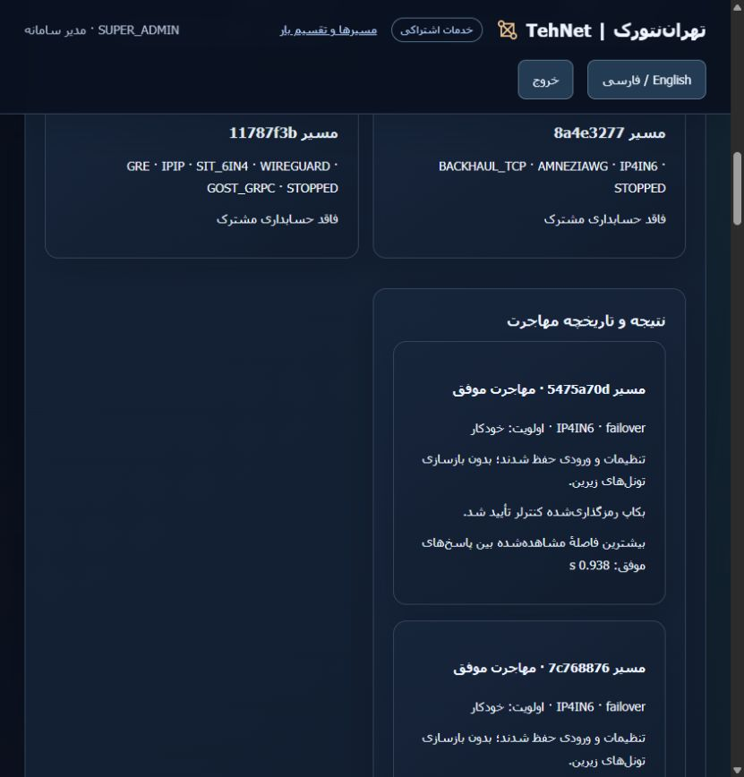
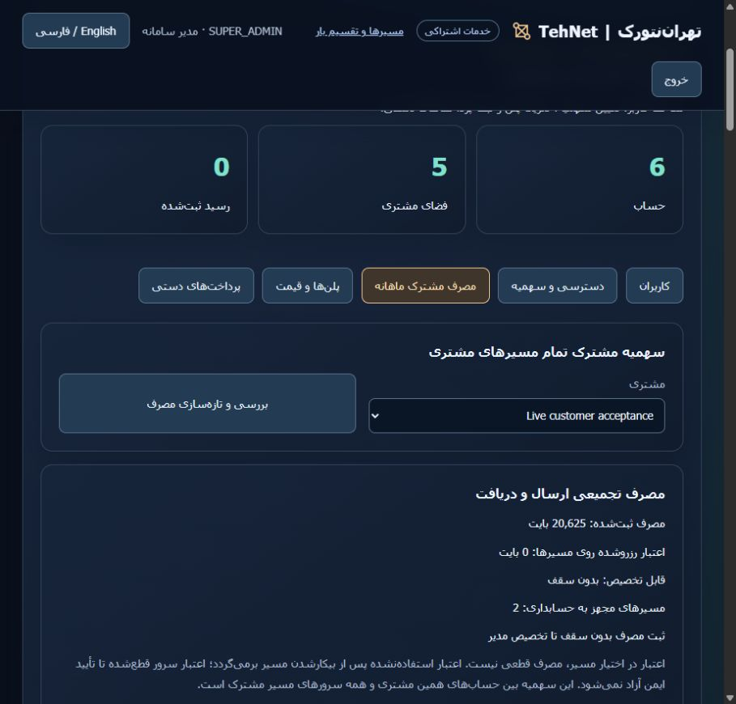
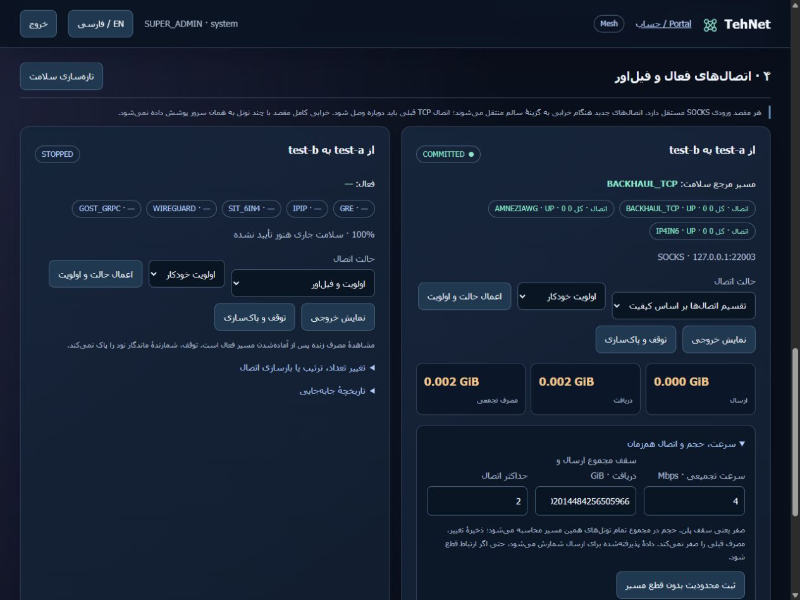

# TunnelPannel

## مهاجرت از پنل ادمین — نصب‌شده

در **[پنل](https://tehnet.ir/tunnels/portal) ← مدیریت کاربران و فروش ← مهاجرت تونل‌های قدیمی** مشتری یا مسیرهای خود مدیر را انتخاب کنید؛ مسیر قدیمی فعال را پیش‌بررسی و سپس با حفظ تنظیمات مهاجرت کنید. ترمینال SSH دستی لازم نیست. نتیجه و ادامهٔ عملیات ناتمام در پنل دیده می‌شود؛ مسیرهای اصلی که از قبل حسابداری دارند دوباره مهاجرت نمی‌شوند. ثبت مصرف تا تخصیص مدیر بدون سقف است.

پذیرش دو مسیر آزمایشی تازه، از API عمومی و دکمه‌های واقعی مرورگر موفق بود. ده عضو اصلی، ورودی‌ها، تنظیمات کامل و هویت پردازش‌ها حفظ شدند. [راهنما](docs/ADMIN-MIGRATION-fa.md) · [نتایج واقعی و محدودیت‌ها](docs/ADMIN-MIGRATION-VALIDATION-fa.md).



## مهاجرت تونل‌های موجود — نصب‌شده

هر دو دروازهٔ اصلی پنج‌عضوی اکنون مصرف را در حساب مشترک همان مشتری، **بدون سقف تا تخصیص مدیر** ثبت می‌کنند. تمام تنظیمات، رمز ورودی، پردازش تونل‌های زیرین و رابط‌ها حفظ شد. بیشترین فاصلهٔ مشاهده‌شدهٔ پاسخ موفق هنگام تعویض فقط دروازه‌ها ۰٫۷۷۴ و ۰٫۷۵۳ ثانیه بود؛ ده رسید عضو و دو ورودی ثابت موفق شدند. [راهنمای مدیر](docs/LEGACY-ACCOUNTING-fa.md) · [گزارش واقعی دو سرور و محدودیت‌ها](docs/LEGACY-ACCOUNTING-VALIDATION-fa.md).

در **پنل ← مدیریت کاربران و فروش ← مصرف مشترک ماهانه** مشتری را انتخاب و مصرف را بررسی کنید. برای تعیین سقف با حفظ مصرف، حجم کل/پایان را **بدون انتخاب دورهٔ جدید** ذخیره کنید. مصرف نامعلوم قبلی ساخته نمی‌شود؛ کار تازهٔ پرداخت‌نشده همچنان رد و حساب/پرداخت کسی فعال نشده است.



## سهمیه مشترک مشتری — نصب‌شده

مدیر می‌تواند مصرف را بررسی کند و یک سهمیه مشترک برای تمام حساب‌ها، مسیرها و سرورهای مبدأ هر مشتری بدهد. در **پنل ← مدیریت کاربران و فروش ← مصرف مشترک ماهانه** سقف حجم و پایان دوره را تعیین کنید، سهمیه را بدون پاک‌شدن مصرف افزایش دهید یا دوره جدید با حفظ سابقه بسازید. مشتری مصرف و اعتبار باز خودش را می‌بیند؛ تخصیص و تمدید دستی است. [راهنما](docs/MONTHLY-USAGE-fa.md) · [آزمون واقعی دو سرور](docs/MONTHLY-USAGE-VALIDATION-fa.md).

تست دو مبدأ دقیقاً در سقف مشترک متوقف شد؛ افزایش سهمیه، انقضا، سابقه دوره جدید و راه‌اندازی مجدد فقط مسیرهای QA موفق بودند. در آن مرحله، ده تونل قبلی، تنظیمات و workerهایشان دست‌نخورده ماندند؛ مهاجرت صریح بعدی در گزارش بالای همین صفحه ثبت شده است. مسیر فعال قدیمیِ فاقد حسابداری باید با تصمیم صریح مدیر مهاجرت کند؛ تا آن زمان فعال‌سازی ناقص سهمیه رد می‌شود و هیچ مسیر قبلی خودکار بازسازی نمی‌شود.


## توسعهٔ موتور و کنترل مصرف TehNet

Backhaul TCP، موتور رسمی AmneziaWG و 4in6 بومی نصب شدند و در دو جهت۶/۶ موفق بودند. worker جدید محدودیت ماندگار سرعت، حجم و اتصال هر مسیر دارد؛ تونل‌های فعلی حفظ می‌شوند. [راهنما و محدودهٔ قابلیت‌ها](docs/TUNNEL-EXPANSION-fa.md).


[مقایسهٔ طراحی و امکانات Arange و اولویت کمبودها](docs/ARANGE-COMPARISON-20261019-fa.md): این بررسی تاریخی کمبودها را مشخص کرد؛ [پذیرش نصب جدید](docs/TUNNEL-EXPANSION-VALIDATION-fa.md) موفقیت۶/۶ Backhaul، AmneziaWG و4in6 بومی را ثبت می‌کند.

سرویس اشتراکی تهران‌نتورک: [مدیریت کاربران، سهمیه، پلن و پرداخت دستی](docs/COMMERCIAL-OWNER-fa.md) · [شواهد نصب فعلی](docs/COMMERCIAL-OWNER-VALIDATION-fa.md). ورود با نام کاربری و رمز: **https://tehnet.ir/tunnels/**. ثبت دریافت وجه و فعال‌سازی دستی مدیر؛ بدون درگاه آنلاین. اصلاح کنترل SIT/WG با CI موفق روی هر دو نود نصب و در تست دوطرفه۴/۴ موفق شد؛ workerهای قبلی حفظ شدند.

[تازه‌ترین شواهد رفع WaterWall و نصب درگاه وب](docs/WATERWALL-GATEWAY-VALIDATION-fa.md): چهار روش در دو جهت موفق؛ حفظ ده عضو فعلی و اجرای همهٔ پردازش‌ها خارج از سرور سایت.

[درگاه وب تهران‌نتورک و اجرای پردازش روی سرورهای جدا](docs/WEB-GATEWAY-fa.md): سرور سایت فقط nginx/SSH درگاه را اجرا می‌کند؛ API، دیتابیس مشتریان، صف کار، تست، کامپایل و تونل روی سرورهای دیگر می‌مانند. اتصال پرداخت به‌ازای استفاده هنوز فعال نیست.

[حالت تست خصوصی، خلاصه پایش و آزمون کیفیت اتصال](docs/TEST-ONLY-fa.md). گزارش تاریخی؛ دامنهٔ عمومی و ثبت پرداخت دستی اکنون مطابق گزارش بالا فعال‌اند.

[گزارش مرحلهٔ قبلی](docs/TEST-ONLY-VALIDATION-fa.md):۱۶٫۸۰ ساعت مشاهده نگهداری‌شده،۲۰۱۴ رسید معتبر TCP دوطرفه، حفظ۱۲ عضو آماده و۷۰۰ تست اصلی لینوکس.


[پنل تجاری، حساب‌ها و راهنمای کامل](docs/COMMERCIAL-BETA-fa.md) · [راهنمای فارسی به‌روز](README.fa.md)

[English](README.md) · [گزارش آزمون واقعی](docs/releases/v0.9.0-rc3/REAL_BENCHMARK.md)

پنل `/mesh` سرورهای مشتری را ثبت می‌کند، تمام جفت‌های جهت‌دار را می‌آزماید، برای هر مسیر تا پنج روش اندازه‌گیری‌شده پیشنهاد می‌دهد و گروه‌های مستقل فیل‌اور آماده می‌سازد. تقسیم بار بر اساس کیفیت، اتصال‌های TCP هم‌زمان را بین تانل‌های سالم پخش می‌کند. کاتالوگ **۱۱۱ شناسه شامل ۹۴ پروفایل و ۱۷ ترکیب پشتیبانی‌شده** دارد؛ شش نام سازگار قدیمی جداگانه شمرده نمی‌شوند. مشتری می‌تواند ترتیب دلخواه و بیش از پنج عضو را تا سقف فضای خود انتخاب کند. [راهنمای کامل و مدیریت مشتری](docs/MESH-fa.md).

گزارش اصلاحات ۸۲ روش قدیمی، شامل مبنای ۲۳ روش ناقص و ۲۷ روش ناموفق، در [گزارش RC3](docs/releases/v0.9.0-rc3/REAL_BENCHMARK.md) محفوظ است. تعداد پیاده‌سازی و تعداد رسید موفق واقعی جدا گزارش می‌شوند.

[راهنمای موتور و سقف سرعت/حجم](docs/TUNNEL-EXPANSION-fa.md) · [پذیرش نصب و شواهد](docs/TUNNEL-EXPANSION-VALIDATION-fa.md)



## نصب تک‌خطی

```sh
curl -fsSL https://raw.githubusercontent.com/DashSaman/TunnelPannel/2c6974a4989a9fab121d2a2f4c161d81fbf379e9/install.sh | sudo env TUNNELPANNEL_VERSION=2c6974a4989a9fab121d2a2f4c161d81fbf379e9 bash
```

این دستور نسخهٔ ثابت و تأییدشدهٔ موتورها و کنترل مصرف را روی سرور کنترلر/پردازش نصب می‌کند؛ روی سرور سایت از نصب‌کنندهٔ مستقل درگاه وب استفاده کنید. هر دو API تست ارتقا یافته‌اند. جزئیات در `install-one-line.txt` ثبت شده است. نصب‌کننده وابستگی‌ها، کاربر برنامه، دیتابیس و systemd را آماده و سلامت HTTP را بررسی می‌کند. نصب مجدد اطلاعات ورود و داده‌ها را حفظ می‌کند و سورس دارای تغییرات محلی را بازنویسی نمی‌کند.

آزمایش واقعی روی Ubuntu 24.04 با معماری amd64 انجام شده است؛ محیط‌های دیگر به آزمون اختصاصی نیاز دارند. پنل روی **127.0.0.1:8080** گوش می‌دهد. روی رایانهٔ خود اجرا کنید:

```sh
ssh -L 8080:127.0.0.1:8080 root@YOUR_PANEL_SERVER
```

سپس برای گردش کار مشتری `http://127.0.0.1:8080/mesh` و برای بنچمارک تک‌جفت `/ranking` را باز کنید. نصب اول توکن‌های نقش‌ها را یک بار نمایش می‌دهد؛ آن‌ها را خصوصی نگه دارید. نصب مجدد هش توکن‌ها را حفظ می‌کند.

## اجرای بنچمارک

1. با توکن مناسب متصل شوید. توکن فقط در حافظهٔ صفحه می‌ماند و پس از اتصال از فیلد ورودی پاک می‌شود.
2. با نقش SUPER_ADMIN، دو سرور را همراه اطلاعات SSH و اثر انگشت SHA256 کلید میزبان ثبت و بررسی کنید. مدیر و اپراتور می‌توانند آزمون را اجرا یا لغو کنند؛ VIEWER نتیجه را می‌خواند.
3. سرورها، روش‌ها و پروفایل را انتخاب کنید. QUICK عبور واقعی داده؛ NORMAL تعداد ۳۰ نمونهٔ تأخیر، انتقال ۱۰ ثانیه‌ای و بازیابی؛ DEEP تعداد ۱۰۰ نمونه و انتقال ۶۰ ثانیه‌ای را می‌سنجد.
4. نتیجهٔ هر روش هنگام پایان نمایش داده می‌شود. تاریخچه، آزمون فعال و پایان‌یافته را باز می‌کند. شکست نصب، انتقال یا پاک‌سازی ناموفق ثبت می‌شود؛ افت کیفیت با دلیل و معیار واقعی نمایش داده می‌شود.
5. لغو آزمون پاک‌سازی را انجام می‌دهد. رابط‌ها، سرویس‌ها و قوانین نامرتبط حذف نمی‌شوند.

برای بروزرسانی اطلاعات ورود، همان نام و میزبان را با اطلاعات جدید ذخیره و دوباره بررسی کنید. شناسه حفظ و بررسی قبلی باطل می‌شود.

## محدودهٔ آزمون

تونل‌های لایهٔ ۳ با ICMP و iperf3 در هر دو جهت؛ پراکسی‌ها با محتوای یکتای مقصد و فایل دارای SHA256 صحیح؛ و UDP با محتوای برگشتی یکتا سنجیده می‌شوند. روش ترکیبی باید با قطع حامل واقعی، انتقال را از دست بدهد و پس از بازیابی وابستگی‌ها دوباره کار کند. HajSaman FULL بومی، مسیریابی سیاستی و SNAT را نیز با مقصد متعلق به آزمون بررسی می‌کند.

CPU و RAM مربوط به کل سرور هستند. تأخیر HTTP با تایمر curl روی سرور اندازه‌گیری می‌شود و سربار رفت‌وبرگشت SSH را ندارد؛ معیارهای هم‌مبنا را مقایسه کنید. نتیجهٔ دو سرور نزدیک به هم، رفتار همین مسیر را نشان می‌دهد؛ انواع NAT، شبکه‌های مسدود، تأخیر جغرافیایی یا مسیر سه‌سروری از آن نتیجه‌گیری نمی‌شود.

مسیر اصلی `apps/api`، `apps/web`، `core` و `orchestrator/pair_runtime.py` است. داشبورد Docker، SDK تک‌اجراگر و ابزارهای قدیمی `deploy/` برای مراجعه باقی مانده‌اند؛ شواهد نسخهٔ جدید جدا از ادعاها و آزمایش‌های محلی آن‌هاست.

## نگهداری

- سرویس: `systemctl status tunnelpannel-api`
- سلامت: `curl -fsS http://127.0.0.1:8080/health`
- بروزرسانی: دستور نصب متصل به نسخهٔ موردنظر.
- پشتیبان: `sudo bash /opt/tunnelpannel/scripts/backup.sh /path/to/backup.tar.gz`
- بازیابی: `sudo env RESTORE_TUNNELPANNEL=YES_I_UNDERSTAND bash /opt/tunnelpannel/scripts/restore.sh /path/to/backup.tar.gz`
- حذف: `sudo bash /opt/tunnelpannel/scripts/uninstall.sh`؛ تنظیمات، داده‌ها و منابع شبکهٔ نامرتبط حفظ می‌شوند.

فایل `/etc/tunnelpannel/tunnelpannel.env` را جداگانه و خصوصی همراه پشتیبان نگه دارید؛ آرشیو کلید نصب را شامل نمی‌شود. کلید نصب و دیتابیس را کنار هم حفظ کنید تا اطلاعات SSH قابل رمزگشایی باشد. رمزهای ارائه‌شده در سورس و گزارش قرار ندارند.

[دفتر وظایف](docs/development/TASK_LEDGER.md) · [کاتالوگ](docs/development/CATALOG_INVENTORY.md) · [گزارش تاریخی مبنا](docs/releases/v0.9.0-rc2/REAL_VALIDATION.md)

کاتالوگ executor قدیمی ۷۷ روش دارد؛ رجیستری پایهٔ ۸۲تایی حفظ شده و افزونهٔ mesh، تعداد ۲۹ شناسه به آن اضافه می‌کند؛ مجموع کاتالوگ ۱۱۱ شناسه است. فقط برای نصب‌های موجود Docker نسل اول، اسکریپت‌های scripts/export-production-state.sh و scripts/restore-production-state.sh و روند رمزگذاری‌شده PostgreSQL آن‌ها را به‌کار ببرید. نصب اصلی از دستورهای پشتیبان‌گیری و بازیابی بالا استفاده می‌کند.


