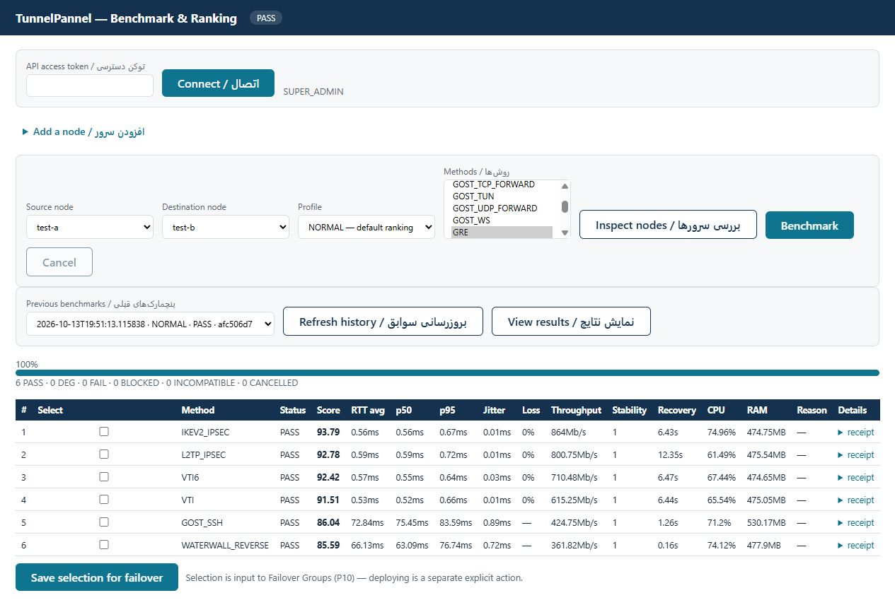

# TunnelPannel

[فارسی](README.fa.md) · [Real two-node report](docs/releases/v0.9.0-rc3/REAL_BENCHMARK.md)

[Complete Persian panel manual](docs/PANEL-GUIDE-fa.md) · [Mesh and connection-sharing validation](docs/MESH-VALIDATION.md) · [Pinned installer](install-one-line.txt)

The `/mesh` panel registers customer servers, tests every directed pair, recommends up to five measured methods per route, and deploys independent warm failover groups. Quality-weighted connection sharing distributes concurrent TCP streams across healthy tunnels. The catalog contains **108 identities: 91 profiles and 17 supported compositions**, with six additional compatibility names. Customers can select their own order and more than five members within their workspace limit. [Full workflow and owner controls](docs/MESH.md).

The original 82-method remediation of the earlier 23 partial / 27 failed methods remains documented in the [RC3 report](docs/releases/v0.9.0-rc3/REAL_BENCHMARK.md). Current implementation counts and real passing receipts are kept separate.

## Install

```sh
curl -fsSL https://raw.githubusercontent.com/DashSaman/TunnelPannel/d757fa836db2ddf838bb1f6897fbb3e30cde3a9c/install.sh | sudo env TUNNELPANNEL_VERSION=d757fa836db2ddf838bb1f6897fbb3e30cde3a9c bash
```

This installs the tested commercial beta revision, also recorded in `install-one-line.txt`. Re-running preserves credentials and data. The installer creates the application account, installs dependencies, migrates the database, starts systemd and verifies HTTP health. It refuses to overwrite local source changes.

Real-node validation uses Ubuntu 24.04 amd64. Other environments need their own validation. The API binds to **127.0.0.1:8080**. From your computer:

```sh
ssh -L 8080:127.0.0.1:8080 root@YOUR_PANEL_SERVER
```

Open `http://127.0.0.1:8080/portal` for owner and customer setup, `/mesh` for warm routes and `/ranking` for a single pair. First installation displays role tokens once; store them privately. Reinstallation preserves their hashes.

## Benchmark workflow

1. Connect with a role token. It stays in page memory and is cleared from the input after login.
2. As SUPER_ADMIN, register two nodes with SSH credentials and pinned SHA256 host-key fingerprints, then inspect each node. OPERATOR/SUPER_ADMIN can start/cancel tests; VIEWER can read results.
3. Select nodes, methods and profile. QUICK checks actual traffic. NORMAL uses 30 latency probes, a 10-second transfer and restart/recovery. DEEP uses 100 probes and 60-second transfers.
4. Results appear incrementally. History reopens active and completed runs. Failed setup, traffic or cleanup remains a failure; performance degradation retains measured metrics and reasons.
5. Cancellation attempts cleanup. Existing interfaces, services and unrelated firewall rules are preserved.

To update credentials, save the same node name and host with new credentials, then inspect it again. Identity stays unchanged and stale inventory is invalidated.

## Measurement scope

L3 uses bidirectional inner-address ICMP and TCP iperf3. Proxy/forward methods verify a remote nonce and SHA256-checked files. UDP validates echoed datagrams. Composites must fail when the actual carrier is stopped and recover after dependency restoration. Native HajSaman FULL also verifies policy routing and SNAT against an owned remote namespace.

CPU/RAM are whole-node measurements. HTTP latency uses the on-node curl timer and excludes SSH round-trip overhead; compare like measurement bases. Two nearby servers establish behavior on these endpoints, not arbitrary NAT traversal, geographic latency, blocked networks or three-server multi-hop operation.

The canonical path is `apps/api`, `apps/web`, `core` and `orchestrator/pair_runtime.py`. Historical `deploy/`, the older single-executor SDK and legacy Docker dashboard remain for reference; their old feature claims and local smoke results are separate from this real-pair evidence.

## Maintenance

- Service: `systemctl status tunnelpannel-api`
- Health: `curl -fsS http://127.0.0.1:8080/health`
- Upgrade: run the pinned installer for the intended revision.
- Backup: `sudo bash /opt/tunnelpannel/scripts/backup.sh /path/to/backup.tar.gz`
- Restore: `sudo env RESTORE_TUNNELPANNEL=YES_I_UNDERSTAND bash /opt/tunnelpannel/scripts/restore.sh /path/to/backup.tar.gz`
- Uninstall: `sudo bash /opt/tunnelpannel/scripts/uninstall.sh`; configuration, data and unrelated network resources survive.

Keep `/etc/tunnelpannel/tunnelpannel.env` separately and privately with backups: the archive excludes installation secrets. Keep the installation secret paired with the database to decrypt node credentials. Supplied server passwords are excluded from source and reports.

[Task ledger](docs/development/TASK_LEDGER.md) · [Catalog](docs/development/CATALOG_INVENTORY.md) · [Historical baseline](docs/releases/v0.9.0-rc2/REAL_VALIDATION.md)

The historical executor catalog contains 77 methods; the preserved base registry has 82 entries and the mesh extension adds 26. The combined catalog has 108 identities. For existing Gen1 Docker installations only, use scripts/export-production-state.sh and scripts/restore-production-state.sh with their documented encrypted PostgreSQL recovery workflow. The canonical installation uses the backup/restore commands above.



## Commercial beta portal

Open `/portal` for invitation accounts, MFA, server onboarding, workload confirmation, objective-based recommendations, subscription controls and operations history. The same cookie session opens Mesh, Benchmark and Topology. [Complete owner/customer guide](docs/COMMERCIAL-BETA.md) · [راهنمای فارسی](docs/COMMERCIAL-BETA-fa.md).

Starter/Pro/Team define bounded server, route, member and daily-test ceilings. The durable queue and atomic reservation protect both Mesh and standalone test APIs. Latency, capacity, stability and balanced objectives retain real receipt qualification and carrier diversity. Recommendations can be limited to protocol-encrypted templates; shortfall is visible.

Dedicated per-node SSH key rotation verifies replacement access before removing old credentials. Optional unprivileged mTLS telemetry accepts typed reports only. Opt-in history retains bounded state and latency observations; support exports exclude raw configuration and credentials. Explicit expiry cleanup stops only the opted-in customer's owned routes. Existing installations and bearer API keys remain compatible.

Billing is sandboxed: no payment is collected and checkout/prices are unconfigured. Public sessions require a configured HTTPS origin; SSH-forwarded loopback previews support local HTTP. Input bodies are capped at64KiB, signed events/telemetry at16KiB. See the [execution ledger](docs/development/COMMERCIAL_LEDGER.md) for installed acceptance status; presence of a feature is separate from a passing hardware result.

[Commercial acceptance report](docs/COMMERCIAL-VALIDATION.md):70 installed checks,10 representative paired passes,12 preserved public exits, restart/queue, key/mTLS and expiry/backup acceptance. This remains an invitation-only TCP beta; payments and public HTTPS are unconfigured.


