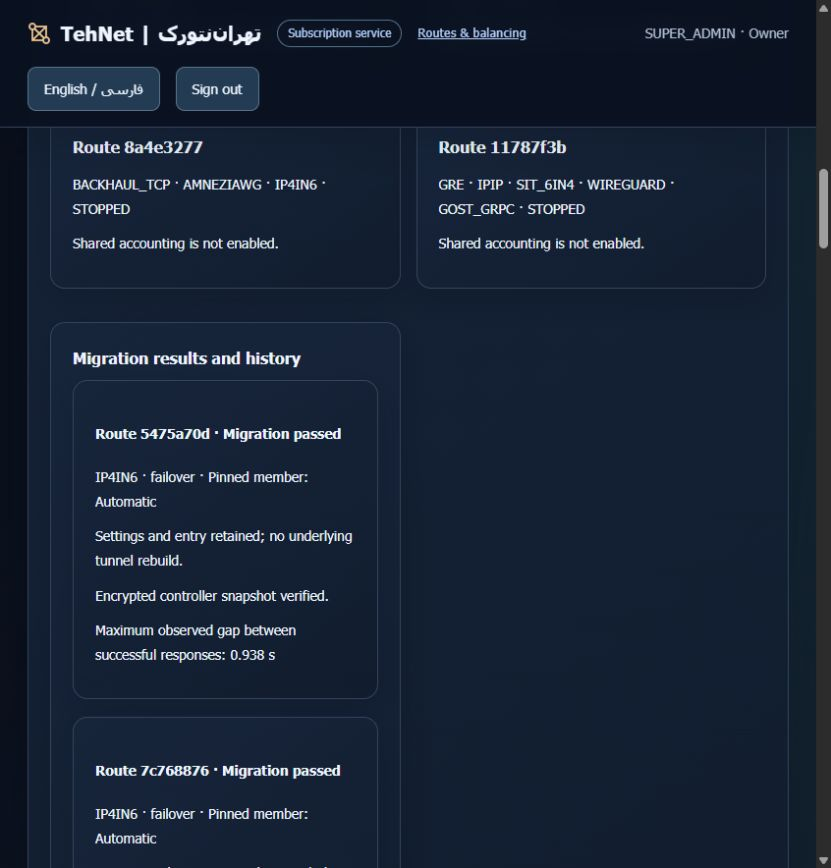

# Administrator migration — installed acceptance, 20 October 2026

The system owner can migrate a registered live legacy route from **Portal → Users & sales administration → Migrate existing tunnels**, without opening an SSH terminal. [Usage guide](ADMIN-MIGRATION.md) · [فارسی](ADMIN-MIGRATION-VALIDATION-fa.md) · [Redacted evidence](evidence/commercial/tehnet-admin-migration-installed.json).

Both execution installations run immutable `2c6974a4989a9fab121d2a2f4c161d81fbf379e9`, tree `d9f9231c47689998370d0be6f350becaad0c77c7`. [Portable CI](https://github.com/DashSaman/TunnelPannel/actions/runs/39435909036) and [security checks](https://github.com/DashSaman/TunnelPannel/actions/runs/39435909027) succeeded before installation. Python 3.12 recorded **841 root tests + 100 TunnelGuard + 1 backend smoke passing**; Linux install/idempotence, backup/restore and safe uninstall passed. Windows recorded 808 passing and 33 POSIX skips; the focused migration suites passed 38 tests. One review found two recovery races; both were reproduced with failing regressions and corrected before rollout.

The static website uses `5237cc405d2a15c14f7ffea9ccd157788ab0f2cb`, tree `9257c68049d77827cba9f114fdbc3d2aa58e44d1`, bundle SHA256 `21467301b69cd136ee706b58276ee0ff8b000e15c9bc768e5333d3ef9687c37b`. Its [portable](https://github.com/DashSaman/TunnelPannel/actions/runs/39434529228) and [security](https://github.com/DashSaman/TunnelPannel/actions/runs/39434529162) checks passed. The later backend correction changes no UI assets; a second static cutover was unnecessary. Documentation/PR heads are independent of these installed pins.

Two new, independent opposite-source native IPv4-in-IPv6 routes exercised the feature. The existing customer's two five-member groups were already metered and were never migrated or restarted again. A used public HTTPS preflight/execute; B used the actual Persian browser controls on `https://tehnet.ir/tunnels/portal`.

| Check | Source A | Source B |
|---|---:|---:|
| Final migration | PASS, explicit pending resume | PASS, browser execution |
| Known pre-cutover payload baseline | 897 bytes | 1,196 bytes |
| Successful / failed nonce samples during cutover | 30 / 4 | 34 / 5 |
| Maximum observed gap between successful responses | 0.924189 s | 0.938379 s |
| Independent verified HTTP body after migration | 1,048,576 bytes | 1,048,576 bytes |
| New pooled accepted payload | 1,057,128 bytes | 1,058,025 bytes |

The first A attempt exposed a real rescue-path parent error before gateway replacement. The product now uses a flat root-private rescue directory, with a failing-then-passing regression. No manual parent-directory workaround was used. After CI and a fresh backed-up API upgrade on each host, explicit fresh preflight resumed the same encrypted pending candidate. The earlier operation is retained as superseded, not rewritten as a first-attempt success.

Both final results verified encrypted online controller snapshots, unchanged entry credentials/settings, zero underlying member restarts and preserved interfaces. Duplicate execute requests retained the same gateway process; already-metered preflight returned 409. Combined new usage was **2,115,153 bytes, held 0**, without a ceiling or expiry. QA-only gateway restarts preserved counters and the pooled total.

An owned completed QA ticket was then changed to RUNNING with its result absent, simulating a crash after route enrollment but before ticket completion. The normal background recovery restored PASS from the encrypted receipt in **30.095 seconds**, with identical gateway PID, configuration, route runtime and counters; no source dispatch or API restart occurred. This checks the controller-result gap. Physical forced rollback and distributed live restore were not performed.

Public HTTPS checks passed for owner and existing customer login, secure cookies, unpaid-new-work refusal, customer denial of both own/system owner-migration namespaces, missing-CSRF refusal, unknown-input refusal and no-store responses. Both languages rendered actual migration results. A 375px viewport override measured client/scroll width 360/360 in both languages; the override was reset. The original customer UI correctly showed both routes already accounted with no repeat migration action.

Only the two new QA routes were normally stopped: six owned deployments rolled back, 42 allocations released, zero live owned allocations. A resident registry rescue preceded removal of the exact temporary system-pool fixtures. Stopped jobs, migration history, source ledgers and checkpoint receipts remain. Unrelated allowance rows were compared and preserved.

Fresh receipts passed through all **10 original members and both stable entries**. Full original gateway configs/PIDs, group payloads, worker identities/interfaces, account credentials and per-installation secrets matched the original-only baseline. The original unlimited customer pool recorded **21,217 bytes, held 0**, after the verification receipts; it was not reset or capped. Twelve coexistence canaries passed on each host; both installations were drained afterward.

Fresh before/immediate-preinstall/after canonical and online source-usage backups plus separate environments were retained per installation. Independent resident encrypted rescues on both execution hosts and the website used separate root0600 keys and verified decrypted SHA256 equality. Controller checkpoint snapshots and source cutover rescues were included; nothing private was exported and no backup was restored over live data.

Only the website's owned static container was replaced. Eleven unrelated containers, 50 links, five selected service PIDs, nginx files and WordPress were preserved and rechecked; no host nginx reload occurred, and the old release remains. Website processing remains static/proxy only. Main is unmerged, PR2 carries the changes, and the old heartbeat remains paused. No customer payment, plan or account was activated by migration.

These finite same-datacenter checks do not establish Iran-path performance, zero downtime, survival of old TCP sessions, foreign-tunnel import or root-resistant billing. Backend execution still requires the existing pinned privileged SSH access; “without SSH” means no manual SSH workflow for the administrator.
