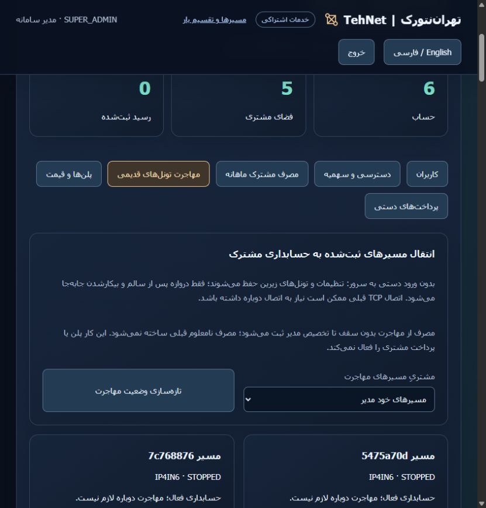

# Migrate an existing gateway from the administrator panel

[Step-by-step screenshots: migration and granting volume](ADMIN-WALKTHROUGH.md)

Installed on both execution controllers and the public website. [Actual two-node acceptance](ADMIN-MIGRATION-VALIDATION.md). This guide supersedes the earlier CLI-only restriction for the system administrator. Existing original groups are already accounted and are not migrated again.

Sign in at **https://tehnet.ir/tunnels/portal** with the system administrator account. Open **Users & sales administration → Migrate existing tunnels**, choose a customer (or **Owner routes**), then choose **Inspect and prepare** on a registered live unmetered route. The preflight checks current configuration, pinned access, gateway ownership, healthy idle state, callback and accounting eligibility. It displays the preserved methods, mode and pin; its ticket expires after two minutes. Already-accounted/stopped routes are clearly labelled. Foreign tunnels outside the panel's ownership are not imported or rewritten.

Choose **Migrate preserving settings** once to start. Execution continues on the execution controller; refreshing or closing the page does not start another operation. The panel polls while running and retains history. Only one migration runs per installation. The server stores the PID/configuration digest and fixed rescue location; the browser cannot override commands, credentials, paths or configuration. Customer administrators, operators and viewers cannot access this owner workflow. Cookie mutations require the existing CSRF and origin checks.

The gateway waits for two fresh healthy idle samples and retains all previous configuration values, entry credentials, member order/weights, balance/failover mode and pin. Underlying tunnels and interfaces are not rebuilt. Existing TCP connections may need to reconnect; results show actual nonce sample failures and the observed gap between successful responses, not a zero-downtime guarantee. Backend access still uses existing pinned SSH credentials; the administrator does not need an SSH terminal or another password entry.

Before dispatch, the controller makes online encrypted snapshots of its operation database, target workspace database and registry and verifies decrypted hashes. These private snapshots remain under the controller workspace directory, with installation encryption keys retained separately through the installation's backup procedure. Source rescue files/configuration/known usage are retained root-private by the existing cutover helper; they are never downloadable from the panel. Rollout backups remain independently encrypted on their original hosts. No environment or customer payment/plan is changed.

Usage starts without a ceiling or hidden expiry until the administrator assigns an allowance. Unknown historical traffic is not invented; known source counters remain, with a separate baseline. In **Shared monthly usage**, assigning a ceiling in the current period retains used and held credit. A customer with an existing real ceiling is refused for this migration rather than silently relaxing it. Disabled customer workspaces remain refused.

If interrupted, inspect the status and use **Inspect and prepare** again on that route. A durable encrypted pending candidate can be resumed without issuing another credential; an already-running exact cutover can be adopted without another restart. If enrollment committed but the ticket completion was lost, recovery uses the encrypted receipt committed in the same route transaction, with no SSH action. Recovery rechecks state under a process-safe lease and commits before releasing it, so it cannot overwrite a completed operation. Earlier attempts completed by a later recovery are labelled accordingly. Startup never launches a cutover automatically. If ownership/configuration or pending evidence cannot be verified, stop and inspect private support evidence; do not clear intent or refund an uncertain live worker.

Owner API: `/api/billing/owner/workspaces/{workspace}/accounting-migrations`, route preflight at `/routes/{route}/preflight`, operation state at `/{operation}`, explicit execution at `/{operation}/execute`. POST bodies are empty objects; unknown fields are rejected. Responses are no-store and expose only allowlisted summaries, never private snapshots, tokens or SSH tracebacks. [Existing migration semantics](LEGACY-ACCOUNTING.md) · [فارسی](ADMIN-MIGRATION-fa.md).
