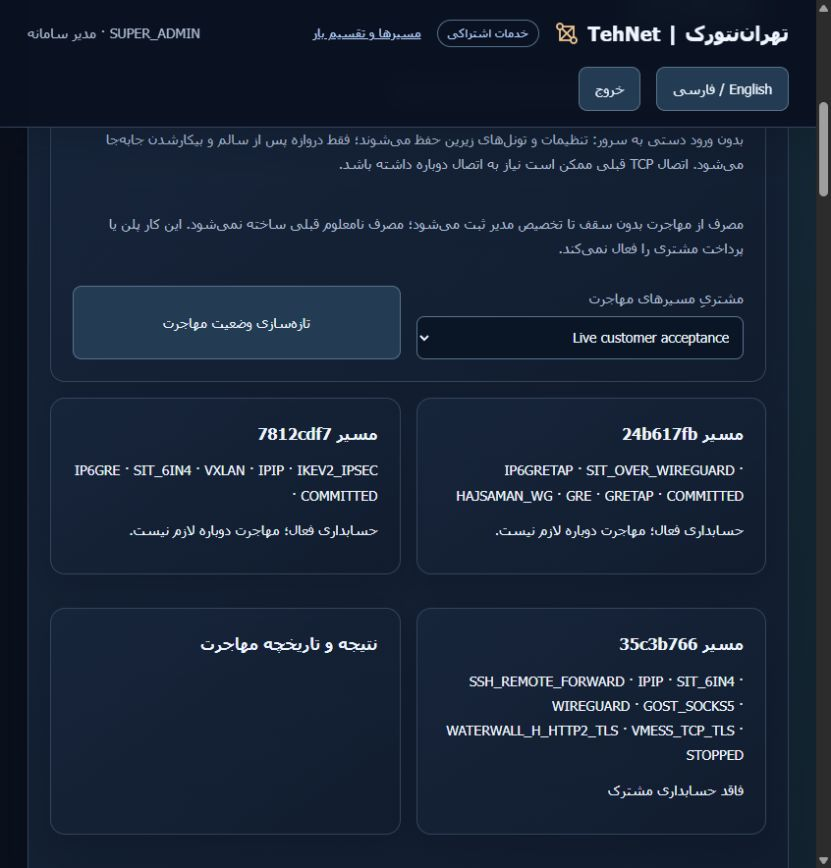
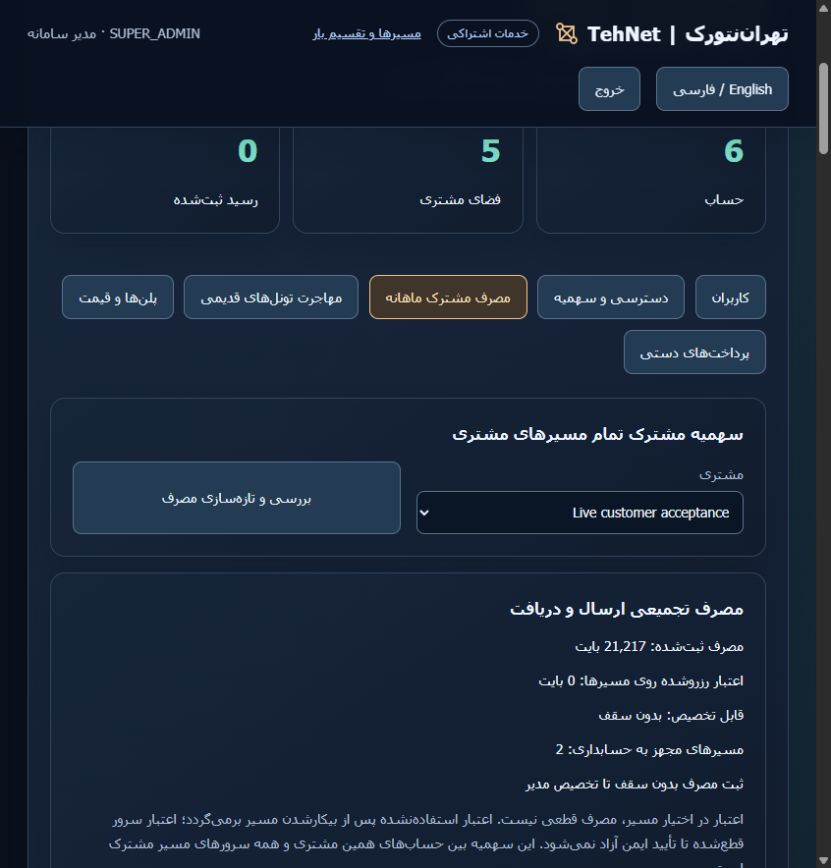
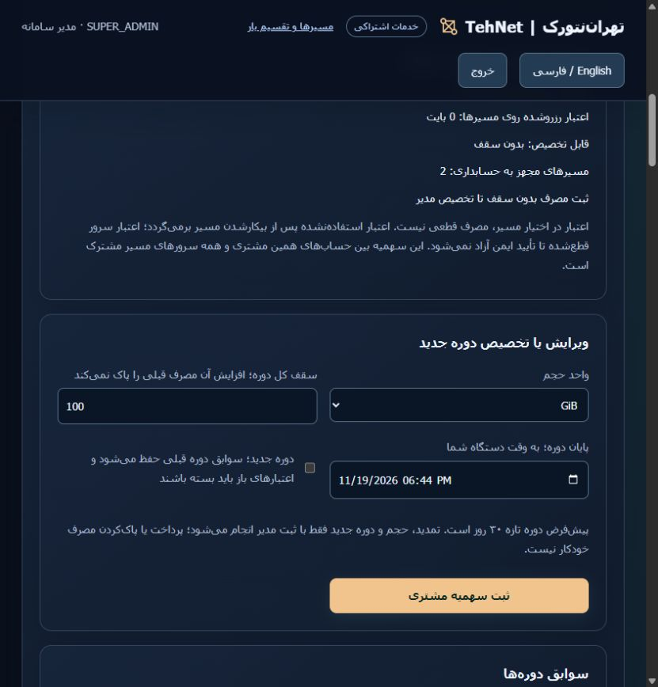

# Illustrated owner walkthrough: customer allowance and legacy migration

[Open the TehNet portal](https://tehnet.ir/tunnels/portal) · [راهنمای فارسی](ADMIN-WALKTHROUGH-fa.md) · [Migration semantics](ADMIN-MIGRATION.md) · [Shared accounting](MONTHLY-USAGE.md)

These screenshots come from the live website. **100 GiB was entered only in an unsaved form.** No quota, migration, preflight ticket, route, payment, installation or worker restart was submitted in this walkthrough. The original routes were already accounted. The successful migration screenshot shows previous QA history, not a new execution.

## 1. Sign in and identify the customer's workspace

Use the system owner account at the public portal; verify `SUPER_ADMIN` in the header. In **Users & sales administration**, identify the workspace containing the intended user. The screenshots use the existing example workspace `Live customer acceptance`; choose the actual customer's workspace in your installation.

Volume is shared by **every account and route in that workspace**, across all participating source servers. Separate users in the same workspace do not receive independent pools; independent allowances require separate customer workspaces. Do not publish passwords or SSH credentials in screenshots.

| Administration tab | Purpose |
|---|---|
| Shared monthly usage | Combined accepted upload/download allowance, period end and retained history |
| Access & quotas | Server, route and test limits; per-route ceilings subject to workspace and subscribed-plan limits |
| Migrate existing tunnels | Enroll registered panel-owned legacy routes, preserving settings |
| Manual payments | Confirm actual received funds and activate access, separately from volume grants |

## 2. Check whether migration is needed

Open **Migrate existing tunnels**, select the same **Migration customer**, and read its route cards. **Owner routes** means the system owner's routes, not an arbitrary customer.

The two original routes below are `COMMITTED` and already accounted. **Do not migrate them again; skip to step 6.** A `STOPPED` card is historical; do not recreate or start it for this tutorial.

## 3. Inspect a live unmetered legacy route

Steps 3–5 describe the future workflow for eligible routes; they were not executed on the originals during this demonstration.

Choose **Inspect and prepare** on a registered live unmetered route. The backend verifies pinned access, gateway ownership, configuration, healthy idle state, workspace eligibility and callback. The resulting **Preflight passed; ready to execute** ticket displays methods, mode, pinned member and a two-minute expiry. Preflight alone does not start cutover.

**Migrate all live unmetered legacy routes before assigning the first real volume ceiling.** Incomplete accounting coverage blocks quota activation, and migration of a customer already subject to a real ceiling requires operator review. Do not remove a ceiling or uncertain pending intent to bypass these guards. Foreign tunnels are not imported by this workflow.

## 4. Explicitly migrate preserving settings

Verify the methods, failover/balance mode and pinned member, then choose **Migrate preserving settings** once. Wait for its final result before migrating another route; one operation runs per installation. If the ticket expires, inspect again.

The controller verifies fresh encrypted online snapshots before source dispatch. Only the selected gateway switches after fresh healthy idle observations; existing entry credentials, port, configuration values, ordered/weighted methods, mode, pin and underlying tunnels/interfaces remain. **Old TCP sessions may need to reconnect; zero downtime is not promised.** The owner needs no manual SSH terminal or repeated credential entry; backend execution still uses stored pinned privileged SSH access.

## 5. Read the result before granting volume

Under **Migration results and history**, wait for **Migration passed**, settings retention and verified encrypted controller snapshot. The route should now show accounting enabled. Closing or refreshing the page does not start a second migration.

The screenshot below is **previous QA history**. Those temporary routes are stopped; no new migration was executed for this walkthrough.

For **Inspection and safe recovery required**, inspect the same route again and, if eligible, choose **Resume preserving settings**. The encrypted pending candidate is retained; an exact already-running cutover can be adopted without another restart. A lost completion result can be recovered from the atomic encrypted receipt without another source action. Investigate ownership, configuration, existing-ceiling or invalid-intent errors rather than deleting/recreating the route.

## 6. Inspect the customer's current usage

Open **Shared monthly usage**, select the customer's workspace, and wait for loading to finish. Use **Refresh usage** if needed. Read confirmed usage, held credit, accounting-enabled routes and the current period before editing.

The live example shows **21,217 accepted bytes, zero held credit, two accounted routes, unlimited until an administrator assigns an allowance**. Held credit is not confirmed usage and is released only after safe reconciliation.

## 7. Example: 100 GiB without resetting usage

1. In **Edit allowance or allocate a new period**, choose `GiB` as **Volume unit**.
2. Enter `100` in **Total period ceiling; increasing keeps previous usage**. This means a total of `107,374,182,400` bytes in the current period, not an additional 100 GiB. Accepted upload and download both count.
3. Set **Period end; your device local time** as desired. The form defaults to roughly 30 days ahead; the screenshot's date is only an example.
4. Leave **New period** **unchecked** to preserve current usage and held credit. The ceiling cannot be below their sum.
5. When you intend a real change, choose **Save customer allowance**, refresh, and verify the new ceiling/end with previous usage retained.

**Step 5 was not performed here.** The screenshot is an unsaved example; the actual pool remained unlimited. A default number displayed in the editor is not an applied ceiling.

## 8. Top up, extend, or deliberately begin a new period

To add 20 GiB to a 100 GiB ceiling, set the total to **120 GiB**, leaving **New period** unchecked. Edit the end time to extend the same period; usage is retained.

Select **New period** only when intentionally starting fresh accounting. Old history remains, and all outstanding credit must be safely closed first. Periods, expiry and renewal are administrator-managed; no automatic charge or monthly reset occurs. Quota assignment and migration do not activate an unpaid customer; confirm actual funds separately through manual payments.

## End-of-demonstration verification

The unsaved example was discarded. Read-only before/after comparison confirmed identical customer workspace settings, allowance/usage/held credit, route inventory and migration-operation history. The two originals remain accounted, with 21,217 bytes used, zero held and no ceiling. No new operation, subscription/payment change, deployment or restart occurred. [Redacted verification](evidence/commercial/walkthrough/verification.json).
