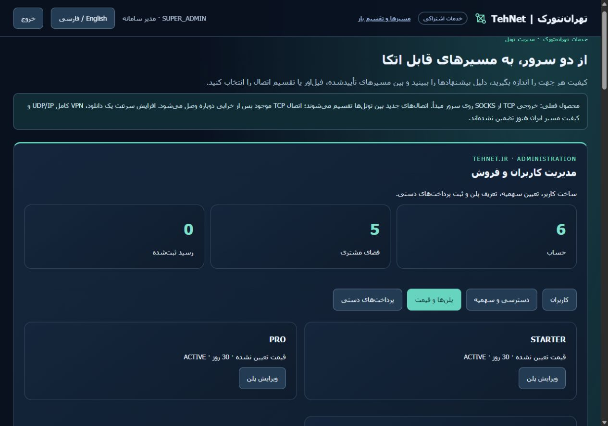

# شواهد نصب مدیریت تجاری تهران‌نتورک — ۲۰۲۶/۱۰/۱۹

پنل روی **https://tehnet.ir/tunnels/** و منوی «مدیریت تونل» سایت در دسترس است.
با نام کاربری و رمز اختصاصی وارد شوید. مدیر سامانه چهار بخش «کاربران»،
«دسترسی و سهمیه»، «پلن‌ها و قیمت» و «پرداخت‌های دستی» را می‌بیند.
[راهنمای کامل مدیر](COMMERCIAL-OWNER-fa.md) · [جزئیات فنی انگلیسی](COMMERCIAL-OWNER-VALIDATION.md)

هر دو بک‌اند اکنون نسخهٔ `97b5af8ba33556aadc8ae580271d9692a1ccce2b` را دارند؛ رابط سایت همان نسخهٔ `e85b4e660ddd0ae8652cce99e5db753216b7cdc7` است و تغییر نکرد. CI اصلی39279868625 و امنیت39279868600 اصلاح جدید پیش از نصب موفق شدند؛
CI نسخهٔ تجاری قبلی39274699149 و امنیت39274699132 نیز موفق بودند. سایت فقط رابط و پراکسی است؛
API، دیتابیس، حساب‌ها، صف، کامپایل، بنچمارک و اجرای تونل روی سرورهای دیگرند.

آزمایش واقعی HTTPS شامل ورود با نام کاربری، جداسازی مشتری و مدیر، منع شروع
تست بدون پرداخت402، منع API مدیر برای مشتری403، فعال‌سازی دستی، جلوگیری از
ثبت دوباره رسید، تعارض409، حفظ سهمیهٔ خرید قبلی، اعمال سقف مشتری و بستن نشست
پس از ویرایش حساب موفق شد. رسید با نام صریح «QA / بدون وجه» بود و هیچ پولی
جابه‌جا نشد. فقط منابع تازهٔ همان QA با نسخهٔ خصوصی قابل‌بازیابی پاک شدند؛
حساب‌ها، فضاها، کاتالوگ و رسیدهای قبلی دقیقاً با مبنای قبل تطبیق داشتند.

قیمت فرضی تنظیم نشده است: ابتدا مبلغ، تومانIRT یا ریالIRR، مدت و سهمیهٔ پلن
را وارد کنید؛ سپس بعد از بررسی دریافت واقعی وجه، رسید را ثبت و مشتری را فعال
کنید. درگاه آنلاین و SSO وردپرس فعال نیست. اعتبار آزمایشی قدیمی به اعتبار
پرداخت‌شده تبدیل نمی‌شود. مدیر برای بررسی سامانه نیاز به خرید پلن خودش ندارد.

رابط فارسی/انگلیسی و موبایل با عرض محتوا و viewport برابر375 تأیید و اندازهٔ
مرورگر بازگردانده شد. در کمپین تازه `64e7ccc80f7d4f519315c7baf87b8e5e` چهار
پروفایل WaterWall در هر دو جهت،۸ نتیجهٔ موفق همراه رسید ثبت کردند.۶ نتیجهٔ
HajSaman با کنترل forwarding مسدود شدند؛ PASS کمپین به معنی موفقیت۱۴ روش نیست.

مسدودشدن SIT و WG ساده، بیش از حد محافظه‌کارانه بود: این دو به forwarding
سراسری نیاز ندارند. تست رگرسیون ابتدا۲ شکست داشت و پس از اصلاح۱۹ تست هدفمند
موفق شد. اصلاح `97b5af8ba33556aadc8ae580271d9692a1ccce2b` منتشر و اکنون
روی هر دو نود نصب شده است؛ صف CI به موفقیت رسید و پیش از نصب، بکاپ و env تازه
و وضعیت گروه‌های همان لحظه دوباره تطبیق داده شد. کمپین جدید
`257d3f9b7f9c43d198f99fdfde993bf7` برای SIT و WG در دو جهت، **۴/۴ نتیجهٔ موفق
با رسید** ثبت کرد؛ هر نتیجه۳۰ نمونهٔ تأخیر، throughput، بازیابی موفق و پاکسازی
۱۶ یا۲۲ منبع متعلق به خودش دارد.۶ شکست محافظتی کمپین اول بازنویسی نشدند.
FULL همچنان بدون تغییر forwarding سراسری خاموش، مسدود می‌ماند.

کنترل‌های هم‌زیستی نصب‌شده روی هر نود۱۲ بررسی موفق داشتند: تشخیص TCP/UDP و
IPv4/IPv6، تونل و سرویس موجود، پورت اشغال و رزروشده، نبود ابزار بازرسی، حفظ
PID اصلی API و پاکسازی فقط canary خودمان. پس از restart مجاز API و تأیید
نبود FD باز، فقط فایل خالیِ ثبت‌نشدهٔ QA قبلی به محل خصوصی قابل‌بازیابی منتقل
شد. دیتابیس مشتری ثبت‌شده‌ای حذف نشد. ورود HTTPS مدیر و مشتری و منع کار بدون
پرداخت پس از ارتقا دوباره تأیید شدند.

ده عضو تونل فعلی، ترتیب روش‌ها، تنظیمات، حالت‌ها و workerهای1140595/873935
حفظ شدند. سرور، سرویس یا ژورنال دیگران حذف نشد. یک انتشار به علت زمان انتظار
کوتاه سلامت و انتشار دیگر به علت تشخیص تغییر مستقل پروژهٔ نرم‌افزار سایت
به کانتینر قبلی خودمان برگشت؛ شواهد حفظ شدند. انتشار نهایی پس از ثبت وضعیت
سالم همان سرویس مستقل،۱۱ کانتینر فعلی دیگر،۵۰ لینک،۵ PID سرویس و فایل‌های nginx
را حفظ کرد؛۱۰ کانتینر اصلی دیگر تغییر نکردند. nginx اصلی reload نشد.

بکاپ تازهٔ قبل/بعد و env و کلید مستقل هر نصب روی خود همان سرور نگه داشته و
با کلید جدا رمزگذاری شد؛ SHA پس از رمزگشایی برابر بود. درگاه وب نیز نسخهٔ
خصوصی مستقل دارد. بکاپ حساس به رایانه منتقل نشد و بازیابی روی دادهٔ زنده
انجام نشد؛ این شواهد ادعای بکاپ خارج از سرور نیست.

خروجی پردازش سرویس‌های جدید متعلق به پروژه دور ریخته می‌شود؛ root همچنان
به فایل‌ها، باینری و حافظه دسترسی دارد و جلوگیری مطلق از کپی شدنی نیست.
منطق تجاری مرکزی روی نود مشتری کپی نمی‌شود؛ سوابق مرکزی حسابداری حفظ می‌شوند.
دو نود هم‌مرکز، کیفیت ایران، مقیاس مشتری زیاد یا افزایش سرعت یک دانلود را
اثبات نمی‌کنند. [شواهد ساختاریافته](evidence/commercial/tehnet-owner-installed.json)
و [مرور upstream](UPSTREAM-REVIEW-20261019.md) محدودیت‌ها را ثبت می‌کنند.
main ادغام نشده است.
