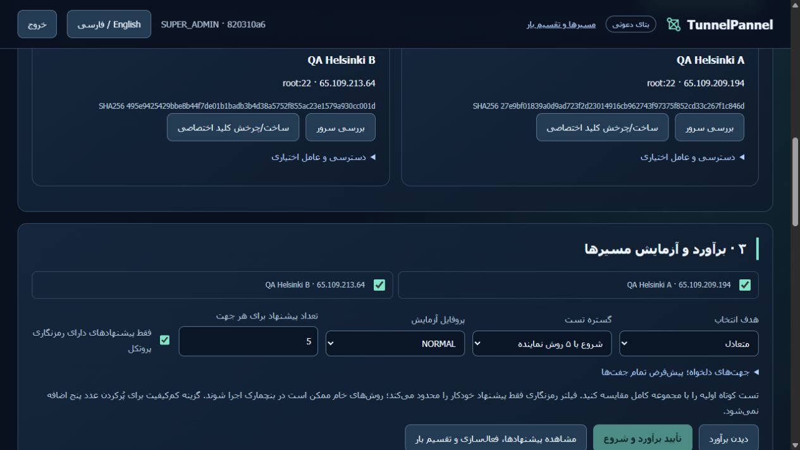

# Commercial beta installed acceptance — 2026-10-16 UTC

[فارسی](COMMERCIAL-VALIDATION-fa.md) · [Owner/customer manual](COMMERCIAL-BETA.md) · [Evidence](evidence/commercial/INDEX.md)

The two-server-testable commercial beta work is implemented and accepted. The installed runtime on both machines is `d757fa836db2ddf838bb1f6897fbb3e30cde3a9c`. The functional account/billing/queue/key/agent acceptance ran at `284adda64cce51ab6acc71cc25efbd02cbe7fa58`; the final delta adds the acceptance harness and a mobile fingerprint wrapping fix. Both final installs, independent identities, live owner/customer sessions, all 12 warm members and fresh agent reporting were checked again. Transport/executor code is unchanged by this final delta.

Scope: two disposable Ubuntu 24.04.4 amd64 Hetzner HEL1 hosts, A=65.109.209.194 and B=65.109.213.64. The original 7+5 member groups remain active. Test tenants are separate. No other physical host was accessed in this continuation. Snapshot collected at `2026-10-16T20:40:52.656457+00:00`.

## Installed results

| Area | Observed result |
|---|---|
| Accounts | Email-bound single-use invitations, wrong-email/reuse rejection, admin/operator/viewer scope, owner 403 boundary, CSRF, logout/session invalidation, TOTP/recovery replay and password change PASS |
| Admission | Actual UI quote 10 units vs 9 denied; no Job created. Restored 500, stale confirmation409, shared worker capacity 1 queued another tenant without an extra test worker |
| Measurements | Actual portal-started NORMAL 5 methods×2 directions:10/10 PASS, 5 qualified per direction, latency objective and encryption filter persisted |
| Crash recovery | SIGKILL with 2 owned live allocations: old child INTERRUPTED/ownership released, mesh resumed with new child/PASS, other tenant dispatched/PASS. Separate standalone interruption cleaned resources and stayed INTERRUPTED |
| SSH keys | Both nodes: bootstrap/new connection/rotation/revocation/replacement/password removal PASS; foreign canary preservation and interrupted-add rollback PASS; exact canaries removed afterward |
| Telemetry | Actual B→A mTLS, unprivileged DynamicUser client/strict filesystem, wrong CA/hostname/missing certificate rejection, replay409, command400, revoked401, CA-preserving rotation, hub/client restart and persistent replay gate PASS |
| Warm operations | Isolated 2+1 QA members deployed. 20 concurrent real nonce receipts were shared across WireGuard and SSH; forced owned SSH outage switched new connections to WireGuard in **8.502s**, including confirmation traffic. Restored balance, unchanged entry credentials/port and gateway PID |
| Subscription | Installed signed sandbox adapter duplicate handling and actual HTTP grace/expiry402/cancel/renew PASS. Default expiry preserved groups; explicit opt-in stopped only QA routes and released ownership |
| Support/history | Actual UP→DEGRADED→UP history; safe export downloadable from browser and after expiry, live credential canaries absent. No raw configuration exported |
| Recovery/install | Private checksummed backups on both; actual backup→benign mutation→restore with integrity/health and own secret preserved. Controller restored account/session/billing/CA identity hashes. Immutable installer rerun on both; no installation identity replaced |
| Original groups |12/12 public destination exits PASS before final CSS-only update; final live nonce health 12/12. Compared stable ports/credentials and exact 7+5 methods with pre-commercial archive: unchanged |
| Browser | Actual server onboarding, account login, owner controls, quota rejection, support download and FA/EN views. 390px viewport has375px client/content width in both languages after the real long-fingerprint overflow fix |

[70 named checks](evidence/commercial/acceptance.json), [final live checks](evidence/commercial/handoff-checks.json), [public exit proof](evidence/commercial/original-warm-public-exits.json), [archive comparison](evidence/commercial/preservation.json), [controller restore](evidence/commercial/controller-restore.json), [peer restore](evidence/commercial/peer-restore.json).

## Representative measured values

These are finite NORMAL experiments on nearby, loaded 1GiB nodes with the 12 older warm members running. RTT is the on-node request measurement, not ICMP. CPU/RAM snapshots include host activity. Loss was 0% in this sample. Capacity is not a promised customer rate or a result for Iran. The recovery column is the benchmark's individual transport recovery; the 8.502s group fault drill above measures a different boundary.

| Direction | Method | RTT ms | Jitter ms | Mbps | Recovery s |
|---|---|---:|---:|---:|---:|
| A→B | HYSTERIA2 | 3.76 | 0.61 | 158.1 | 0.170 |
| A→B | SSH_REMOTE_FORWARD | 3.50 | 2.57 | 166.0 | 5.983 |
| A→B | VMESS_TCP_TLS | 9.61 | 2.42 | 343.0 | 0.152 |
| A→B | WATERWALL_H_HTTP2_TLS | 7.07 | 0.82 | 292.2 | 0.731 |
| A→B | WIREGUARD | 2.73 | 0.73 | 603.9 | 0.440 |
| B→A | HYSTERIA2 | 2.38 | 0.43 | 160.9 | 0.146 |
| B→A | SSH_REMOTE_FORWARD | 4.74 | 4.87 | 169.4 | 5.957 |
| B→A | VMESS_TCP_TLS | 12.87 | 2.13 | 342.8 | 0.141 |
| B→A | WATERWALL_H_HTTP2_TLS | 7.34 | 1.13 | 312.4 | 0.688 |
| B→A | WIREGUARD | 2.50 | 0.57 | 614.3 | 0.375 |

Exact finite numbers and selected orders are retained in [JSON](evidence/commercial/acceptance.json) and [CSV](evidence/commercial/representative-metrics.csv). Historical full 108-identity/216-direction testing and composition source review remain in [Mesh validation](MESH-VALIDATION.md); the 216 matrix was not rerun for management/UI-only changes.

## Fresh software verification

Final runtime [portable CI](https://github.com/DashSaman/TunnelPannel/actions/runs/38963184697) and [security CI](https://github.com/DashSaman/TunnelPannel/actions/runs/38963184676) PASS. Python3.11 and 3.12 each: 692 canonical+100 TunnelGuard+1 backend PASS. Linux fresh install/idempotence/backup-mutate-restore/safe uninstall, ShellCheck, syntax, Ruff and catalog invariants PASS. Windows:670 canonical PASS/22 platform skips;89 TunnelGuard PASS/11 skips;1 backend PASS. Dependency deprecation warnings are retained in logs. [Machine-readable verification](evidence/commercial/verification.json).

Early Windows collection and shell/which PATH problems were corrected in the runner, without changing product behavior. Acceptance harness assumptions about session factories, resource fields and SSH unit prefixes were corrected after reading complete failures/ownership records. An initial delayed crash guard safely skipped. The installer refused the temporary tested CSS edit; only that hash-verified owned edit was restored before immutable installation. Raw logs and private recovery archives remain on the test servers; credentials are excluded from this repository.

## Install, access and operate

```sh
curl -fsSL https://raw.githubusercontent.com/DashSaman/TunnelPannel/d757fa836db2ddf838bb1f6897fbb3e30cde3a9c/install.sh | sudo env TUNNELPANNEL_VERSION=d757fa836db2ddf838bb1f6897fbb3e30cde3a9c bash
```

Open `/portal` through an SSH loopback forward; the canonical API stays on 127.0.0.1:8080. Two private handoff accounts exist: system owner and original-group customer. Their credentials are in the private handoff file supplied separately and `/root/tunnelpannel-commercial-access.txt` on A. The predictable old demo API key was revoked. Enable your own MFA after handoff. Each node keeps its own installation secret. Current private backups are `/root/tp-commercial-acceptance/handoff-current.tar.gz` plus checksum on each host; keep the installation encryption key separately and do not exchange encrypted databases between hosts.

Monitoring on the original groups is explicitly enabled at 60s. At this snapshot it had run **858.1s**, with 28 retained samples and 6 transitions. Seven days is the retention ceiling, not an elapsed availability test. Alerts are in-panel only. The optional 30-day agent certificate requires rotation/reinstallation before expiry.

The workflow is owner workspace→invite→sandbox activation→customer SSH onboarding→estimate→test→receipt-qualified suggestions→custom/default selection→warm failover/balance. Each destination has an independent SOCKS entry. More than 5 members needs the corresponding plan and workspace cap. Sharing works across new TCP connections; existing sessions reconnect after failures. A single destination outage still loses every tunnel terminating there. No single-stream bonding or full UDP/IP VPN claim is made.

## Remaining external launch prerequisites

Public domain/trusted HTTPS, actual payment checkout/provider callbacks, real Iran and multi-country pilots, longer soak and many-customer load testing need inputs/time outside this two-host acceptance. Prices and checkout are unconfigured; no payment was collected. SMTP and external notifications are unconfigured. Do not present this closed beta as a paid public SLA service yet.

Code and evidence are on the existing [PR2 branch](https://github.com/DashSaman/TunnelPannel/pull/2); the immutable installer works independently of a main merge. The native PR title and description were refreshed. Main remains unmerged and the working branch is preserved for review.



[English view](evidence/commercial/screenshots/live-portal-en.jpg) · [Persian mobile](evidence/commercial/screenshots/live-mobile-fa.jpg) · [English mobile](evidence/commercial/screenshots/live-mobile-en.jpg) · [Owner session](evidence/commercial/screenshots/live-owner-fa.jpg)

[Live observed history of the original7+5 groups](evidence/commercial/screenshots/live-operations-fa.jpg).
