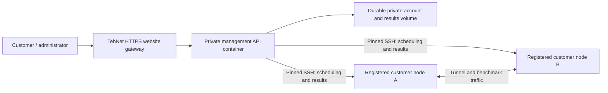

# Durable TehNet management

The owner confirmed on 31 October 2026 that both original test nodes were removed. The website still served its static files, but its SSH API upstream no longer existed. Nginx returned HTML502 and the page attempted to parse it as JSON. The installed release **c0291d65750483a1782d0e81affe4117479a66a1**, tree **d134d4dc18192153aa71c0e039ec18ba0871f4c9**, adds a permanent, separate management container and safe bilingual handling of upstream failures. Exact [portable/lifecycle/container41227301471](https://github.com/DashSaman/TunnelPannel/actions/runs/41227301471) and [security41227301476](https://github.com/DashSaman/TunnelPannel/actions/runs/41227301476) are successful. [Actual redacted acceptance](evidence/commercial/control-plane-installed.json).

## Architecture

The management process coordinates work, authenticates accounts, maintains plans/manual payment records, and stores results and shared allowance state. It does not carry customer tunnel payloads. Measurement commands, tunnel workers and managed forwarding remain on the registered customer nodes. Background reconciliation is management work and uses bounded SSH calls.

`deploy/control-plane/compose.yaml` runs one API process as UID10001, with a read-only root filesystem, all capabilities dropped, no Docker socket or host network, a512MiB memory limit and0.5CPU limit. A dedicated bridge has a loopback-only published port. The website's existing proxy remains separate. Actual required capacity depends on accounts and concurrent work; these limits are deployment caps, not a throughput promise.

`TP_CONTROL_PLANE_ONLY=1` requires `TP_CONTROLLER_EXCLUDED_HOSTS` containing every website-host/interface address. `TP_RETIRED_NODE_HOSTS` blocks deleted endpoints. Loopback, link-local, unspecified and multicast targets are refused. DNS targets are validated and connected using the same resolved numeric address, with the registered SSH fingerprint still enforced. Configure `FORWARDED_ALLOW_IPS` to the dedicated Docker bridge gateway only; public sessions require `TP_PUBLIC_ORIGIN=https://tehnet.ir` and HTTPS.

## Persistent state and recovery

Keep the private environment and `/data` outside the container image. Replacing the container must reuse the same volume and installation encryption key. The latter is required to decrypt existing node credentials and MFA seeds. Do not commit either to Git. Use manual billing mode; no provider or fabricated payment is added.

The available verified rescue is dated **2026-10-18T17:24:57Z**, with five workspaces and six accounts. Changes after that snapshot, including later trial/usage evidence, cannot be reconstructed from it. Keep its authenticated encrypted archive and independently protected key. Restored completed jobs retain their payloads/history. Pending old work is marked interrupted and old monitoring disabled before the API starts; no historical deployment is replayed. Removed hosts are denied before authentication. The owner sees the snapshot date and an explicit historical-state notice.

The offline initializer is `python -m scripts.control_plane_admin`, with a private JSON object on stdin containing `username`, `password` and, only for an old rescue, `retire_pending:true`. Run it in a stopped container with the intended private data volume. It upgrades schemas, preserves other accounts, and creates/updates only the explicitly named system owner. Never bake a default password into an image or expose it in command arguments. Restore obsolete sessions as revoked, not authenticated users.

Take fresh SQLite-consistent backups of the canonical database and every workspace/registry database, plus the separate installation environment/key, before and after upgrades. Encrypt archives, retain independently protected keys, verify decryption and hashes, and keep an off-host copy under the owner's control. A snapshot on a deleted VPS cannot recover that VPS. Do not restore a historical snapshot over a newer active database.

## Administrator workflow

Open [the portal](https://tehnet.ir/tunnels/portal), sign in with the privately supplied administrator login, then use **Users & sales administration** to create a customer workspace/account, edit plans and limits, and record a genuine offline payment before manual activation. Accounts within one workspace share its allowance; use separate workspaces for independent customers.

For shared volume, select the customer and set the total period ceiling. Keep “new period” off to preserve current consumption; granting100GiB does not mean100GiB of data has been transferred. See [the illustrated quota/migration walkthrough](ADMIN-WALKTHROUGH.md). Legacy-route migration requires a live owned source with the original worker/configuration; removed endpoints cannot be migrated. Do not recreate old groups from history.

Register and discover new customer nodes before estimating or starting real tests. No new real two-node throughput/firewall acceptance can be claimed while the owner has no test nodes. The separate resource/firewall feature work remains uninstalled pending its own acceptance.

## Verification and status

Local recovery checks: the original HTML regression failed before the fix; focused browser/package/boundary/restore checks passed. A fresh Windows root suite passed935tests, skipped52POSIX-dependent tests and reported two existing deprecation warnings. The real isolated container verified login, owner/customer creation, CSRF refusal, nonroot capability restrictions and persistence across a restart, with no tunnel tools installed. Its idle observation was about79MiB; this is not a load benchmark. The exact immutable release passed native CI and is installed on the permanent management and website containers. Actual public HTTPS owner login/logout, administrator reads, unauthenticated refusal, TLS origin validation and assets passed. An isolated nginx canary returned JSON503/no-store without stopping the live API. Fourteen other running containers, twenty nginx configuration hashes, thirty-four baseline interface configurations and five service PID records were preserved. Live bridge countdowns were normalized only for configuration comparison; raw observations remain private. Fresh resident before/final-after rescues and separately held keys were encrypt/decrypt/SHA verified; new private data was not exported. The observed deployed management process used about84MiB at idle under its512MiB cap. Browser visual acceptance and new photographs remain unavailable because no browser surface was connected; opening the real panel is queued for the owner. No new real two-node tunnel result is claimed.

[فارسی](CONTROL-PLANE-fa.md)
