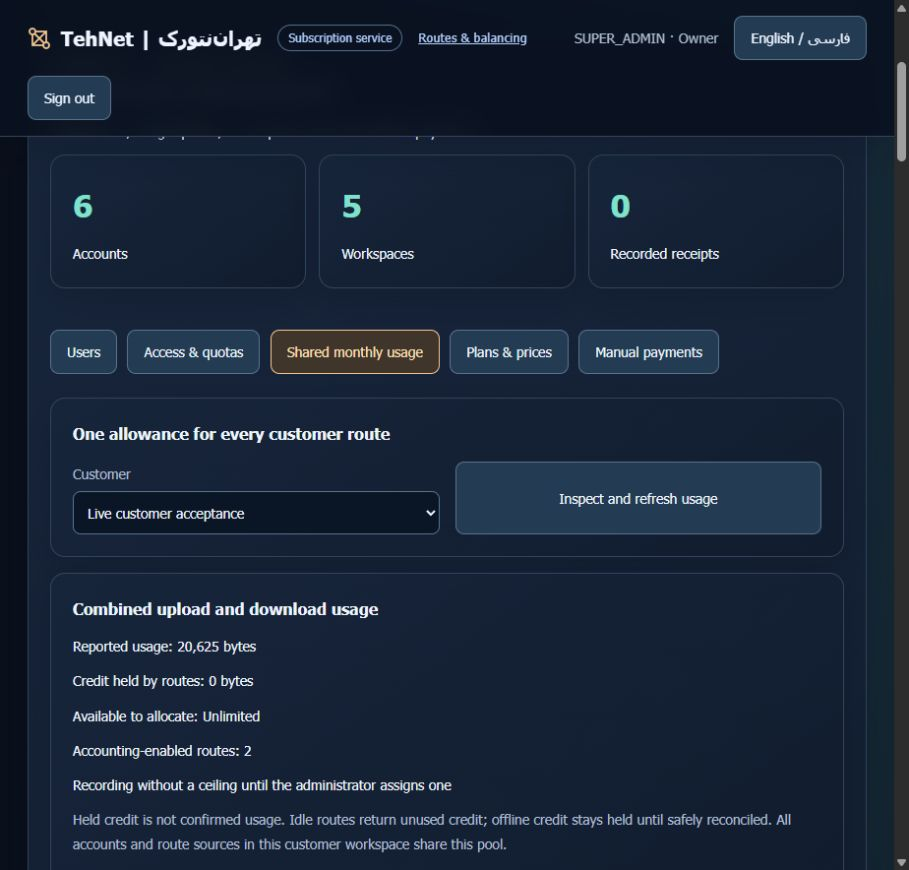

# Installed existing-gateway accounting — 20 October 2026

The two execution installations and [public TehNet panel](https://tehnet.ir/tunnels/portal) run functional source `808b72975fa980a378f42d28b2324606955031d2`, tree `55f0a2af421e331e155cb9276c93e09bc817a1cb`. Static bundle SHA256: `937b18232a4d1681449514e32413ea9af17e5b58e1ce1f1d0491f338834bab54`. Documentation may advance independently; the one-line installer pins this accepted runtime.

Both original five-member gateways now share their existing customer's accounting pool. The owner chose **record usage without a ceiling until the administrator assigns one**: no artificial maximum, expiry or payment activation. Unknown traffic before migration is not invented. Original workers had no durable ledger; their recorded source baseline was zero. Existing source counters on the separate QA routes were retained and subtracted as a baseline.

## What was preserved

Only the two selected gateway workers were replaced, sequentially after exact configuration/PID checks and two fresh healthy idle observations. Entry address, port and credentials; all old configuration values; upstream order/weights; failover/balance mode, pin and probes were preserved. All underlying tunnel worker identities and interface indices stayed unchanged. The unrelated historical route was retained. Account/password/MFA/workspace, installation keys, root access, plan and payment state were preserved. Existing explicitly enrolled traffic remains entitled while unpaid **new** work and disabled-workspace credits remain refused.

| Original group | Methods in preserved order | Successful / failed monitor samples | Maximum observed success gap |
|---|---|---|---|
| A, failover | IP6GRETAP, SIT_OVER_WIREGUARD, HAJSAMAN_WG, GRE, GRETAP | 37 / 3 | 0.774444 seconds |
| B, balance | IP6GRE, SIT_6IN4, VXLAN, IPIP, IKEV2_IPSEC | 37 / 4 | 0.752631 seconds |

Monitor requests used genuine nonce receipts, a50ms interval and600ms request deadline. These are observed gaps between successful samples, not exact socket outage or a promise of uninterrupted old TCP sessions. All ten direct member receipts plus both stable-entry receipts passed afterward. Stable-entry verification added296 payload bytes on each source. At the final snapshot, source totals10,163 +10,462 equalled pooled usage20,625 bytes, held0, with2 managed and0 unmetered original routes. Health probes sent directly to members bypass gateway accounting; requests sent through the stable SOCKS entry count as accepted payload.

## Independent physical QA before the originals

Two new opposite-source native4in6 routes were created without a shared pool. Both migrated successfully, preserving897 previously known source bytes per route. A deliberately failed final metadata commit left a durable encrypted pending candidate; retry adopted the same running gateway without a second restart. The second route used the normal path. Initial observed success gaps were0.890080/0.926865seconds.

Both sources delivered1,048,576 verified body bytes in parallel. Pooled new usage2,115,751 matched the sum of source counters minus their baselines. QA-only gateway restart retained that value. Through the public HTTPS administrator API, the first real ceiling35,670,306 was assigned in the same period, retaining2,115,751 used/0held. Concurrent transfers stopped at exactly35,670,306; a further request on each source passed0payload bytes. Original customer traffic was left unlimited.

Only these two QA routes were stopped:6 deployments rolled back normally,42 allocations released,0live allocations. The temporary system-workspace allowance rows were removed after a full resident registry rescue; unrelated rows, stopped jobs, resource history and source ledgers were retained. Fault-injection unit tests cover preflight/idle/rolled-back/uncertain metadata paths. This run physically tested metadata-loss recovery, not a forced physical rollback or distributed live restore.

## Website, UI, backups and checks

Only the dedicated static/proxy web container was replaced. Eleven unrelated containers,50links, five selected service PIDs, nginx files and WordPress stayed unchanged; no host nginx reload. All API/accounting/SQLite, builds and test traffic remain on execution hosts. The old static release remains available.

In **Portal → Users & sales administration → Shared monthly usage**, select the customer to inspect both routes, reported/held usage and unlimited history. To impose a ceiling, set the total volume and end date, then save **without New period** to retain current consumption. Lower than used+held is refused; a new period retains history and requires held credit closed. No cap was assigned to the original customer. Both public administrator and existing customer login/secure-cookie/unpaid-new-work guards passed. The isolated customer UI fixture and first-cap/held-credit refusal passed before rollout. Actual public FA/EN unlimited readouts passed; mobile375px override produced360/360 client/scroll widths in each language, then was reset. Language changes rebuild the administrator view; reselect the customer afterward.

Fresh before, frozen immediate-preinstall, pre-migration and after canonical/source-usage backups plus a separate installation environment were retained **on each original host**. Each host and the website have independently encrypted resident rescues, separate root0600 keys and matching decrypted SHA256. No sensitive export or live restore was performed. Twelve installed coexistence canaries passed on each execution node; both installations ended drained.

Accepted functional CI: [portable39423550160](https://github.com/DashSaman/TunnelPannel/actions/runs/39423550160), [security39423550271](https://github.com/DashSaman/TunnelPannel/actions/runs/39423550271), both successful, including Python3.11/3.12 and Linux lifecycle. Observed3.12 results831root +100TunnelGuard +1backend passed. Earlier candidate had830pass/1failure because a historical-worker test fabricated observation without a database Job; the fixture was corrected, regression25/25 passed and CI reran successfully before installation. The failed candidate was never installed.

[Migration/recovery guide](LEGACY-ACCOUNTING.md) · [فارسی](LEGACY-ACCOUNTING-VALIDATION-fa.md) · [Redacted evidence](evidence/commercial/tehnet-legacy-accounting-installed.json). PR2 remains unmerged; heartbeat remains paused. No payment gateway, SSO, server deletion or root-tamper-proof billing claim.
