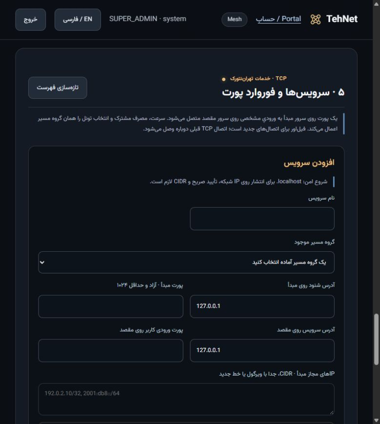
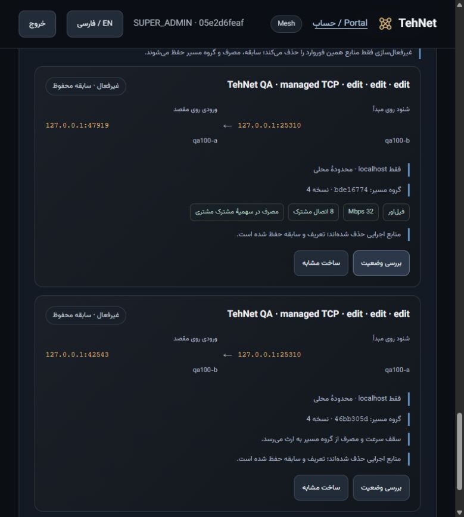
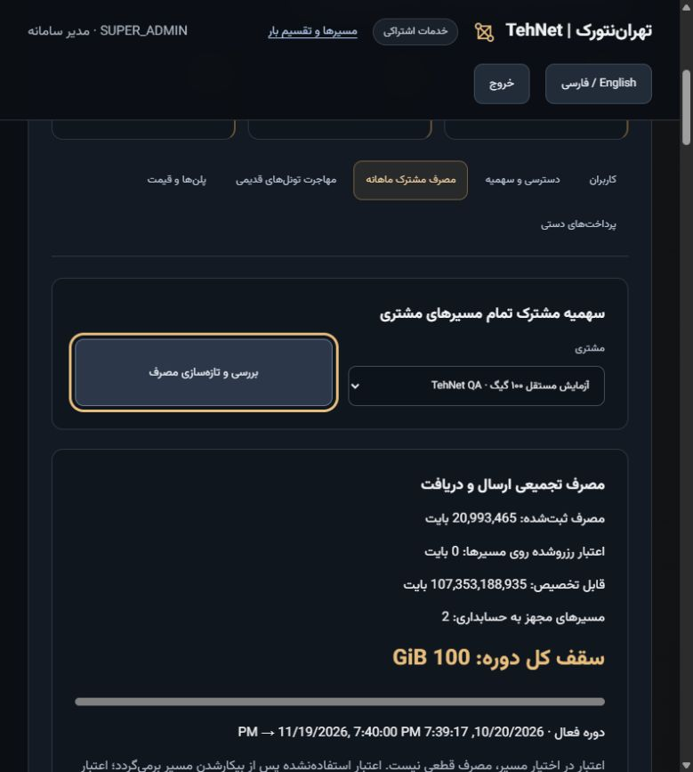

# سرویس TCP و فوروارد پورت — نصب‌شده

[English](MANAGED-TCP-SERVICES.md) · [ورود به پنل](https://tehnet.ir/tunnels/portal) · [رسید آزمون‌ها](evidence/commercial/managed-services-installed.json)

هر دو API اجرایی و کانتینر مستقل سایت نسخهٔ **e7d79cc8f6b136328dcc2cc497b13d366bbb6d4a**، با tree **8ac2b8a08d9759c08f621bfb14a2a103b038a291** را دارند. سرور سایت فقط فایل‌های رابط و پراکسی را ارائه می‌کند؛ ترافیک تونل، پردازش، SSH، پایگاه داده و حسابداری روی نودهای اجرایی می‌ماند. فوروارد جدید از گروه مسیر همان مشتری و حسابداری موجود عبور می‌کند.

## مراحل استفاده

۱. با نام کاربری و رمز خود در Portal وارد شوید؛ **تونل‌ها و تقسیم بار ← فوروارد پورت** را باز کنید. حساب مدیر سامانه فضای system را می‌بیند؛ برای گروه‌های مشتری با حساب همان مشتری وارد شوید. مدیر سهمیهٔ مشتری‌ها را از Portal مدیریت می‌کند.

۲. یک گروه مسیر آماده با مشاهدهٔ معتبر انتخاب کنید. گروه مشتری باید حسابداری مشترک داشته باشد. مسیر قدیمی بدون حسابداری را ابتدا از [مهاجرت مدیر](ADMIN-MIGRATION-fa.md) با حفظ تنظیمات مهاجرت دهید. ساخت فوروارد هیچ مسیر اصلی را خودکار مهاجرت یا ری‌استارت نمی‌کند.

۳. نام، آدرس شنود و پورت آزاد مبدأ بین ۱۰۲۴ تا ۶۵۵۳۵ و IP و پورت ورودی سرویس مقصد را بدهید. `127.0.0.1` در شنود به سرور مبدأ و در مقصد به سرور مقصد اشاره می‌کند. الگوی 3x-ui فقط مقصد localhost:443 را پیشنهاد می‌دهد؛ پورت **ورودی کاربر** واقعی را جایگزین کنید. رمز، UUID یا پنل مدیریت x-ui خوانده نمی‌شود.

۴. پیش‌فرض localhost است. برای انتشار روی شبکه، تأیید صریح و CIDR مشتری‌های مجاز لازم است. فایروال سراسری تغییر نمی‌کند. پورت اشغال، مقصد مدیریتی/پایگاه داده یا پورت محافظت‌شده رد می‌شود.

۵. **بررسی تازهٔ پورت و مسیر** و سپس **اعمال تنظیمات تأییدشده** را بزنید. تغییر هر ورودی تأیید قبلی را باطل می‌کند. **بررسی وضعیت** مشاهدهٔ تازهٔ worker و شنود را نشان می‌دهد؛ این مشاهده سلامت برنامهٔ مقصد یا SLA را ثابت نمی‌کند.

۶. **ویرایش** نسخهٔ جدید و checkpoint خصوصی بازیابی می‌سازد. فقط همان فوروارد قطع کوتاهی دارد و اتصال TCP باید دوباره برقرار شود؛ gateway و اعضای گروه ری‌استارت نمی‌شوند. در حالت نیازمند بازیابی، **بررسی و بازیابی** را استفاده کنید. **غیرفعال و حذف منابع فوروارد** فقط منابع همان فوروارد را برمی‌دارد؛ تعریف، سابقه، مصرف و گروه مسیر حفظ می‌شوند. برای رکورد متوقف‌شده، **ساخت مشابه** فرم تازه می‌سازد.

سقف سرعت، تعداد اتصال مشترک، فیل‌اور/تقسیم اتصال و مصرف از گروه مسیر می‌آیند. این قابلیت TCP است؛ تقسیم چند اتصال، سرعت یک اتصال TCP را به جمع سرعت همه تونل‌ها تبدیل نمی‌کند.

رابط واقعی مشتری، دو گروه والد آماده و دو فوروارد متوقف‌شدهٔ نسخهٔ ۴ را نشان داد. «ساخت مشابه» فقط فرم را پر کرد؛ اعمال تا بررسی تازه غیرفعال ماند و چیزی ثبت نشد. در آزمون موبایل فارسی/انگلیسی عرض صفحه و محتوا هر دو ۳۶۰ بود؛ ابعاد بعد از آزمون برگردانده شد. [هش عکس‌ها و دامنهٔ بررسی](evidence/commercial/managed-services-screenshots.json).

## سهمیه و فروش

**Portal ← مدیریت کاربران و فروش ← مصرف مشترک ماهانه**؛ مشتری را انتخاب و مصرف را بررسی کنید. برای افزایش سهمیه با حفظ مصرف، سقف کل را تغییر دهید و **دوره جدید را خاموش نگه دارید**. دوره تازه فقط با اقدام صریح مدیر ساخته می‌شود. ثبت پرداخت و فعال‌سازی دستی مستقل باقی است؛ درگاه آنلاین اضافه نشده. دسترسی internal_test مشتری آزمایشی به معنی دریافت پول نیست.

## نتیجهٔ واقعی دو سرور

دو فوروارد مستقل localhost روی گروه‌های 4in6 حفظ‌شده با سرعت ۳۲ مگابیت و ۸ اتصال مشترک آزموده شدند. چهار پاسخ هم‌زمان مستقیم/فوروارد یک MiB با هش صحیح، فقط **۴٬۱۹۵٬۰۴۸ بایت** شامل درخواست و پاسخ از حسابداری موجود کم کردند. در دور بعد، TIME_WAIT واقعی مشاهده شد و ویرایش هر دو فوروارد از API در مجموع ۲۱٫۱۵۷ ثانیه به نسخهٔ ۴ رسید. ری‌استارت فقط فورواردها نیز بدون تغییر PID، تنظیمات و مصرف گروه‌های والد موفق بود.

سقف موقت **۲۰٬۹۹۲٬۵۴۹ بایت** دقیقاً پر شد؛ چهار درخواست بعدی مستقیم/فوروارد هیچ هدر یا بدنه‌ای دریافت نکردند. سپس ۱۰۰ GiB برابر **۱۰۷٬۳۷۴٬۱۸۲٬۴۰۰ بایت** در همان دوره و بدون پاک‌کردن مصرف برگشت. چهار پاسخ nonce تازه موفق شدند و دقیقاً ۹۱۶ بایت ثبت شد. مصرف نهایی مشاهده‌شده **۲۰٬۹۹۳٬۴۶۵ بایت** و اعتبار رزروشده صفر است. این آزمون سقف کوچک بود، نه انتقال ۱۰۰ گیگ داده.

هر ۱۰ عضو اصلی و ۲ ورودی پایدار رسید تازهٔ موفق دادند. روی هر سرور ۲۸ سرویس اصلی فعال با زمان شروع پیش از ارتقا حفظ شدند. تنظیمات، دسترسی‌ها، PID و اینترفیس‌های اصلی و دو گروه QA حفظ شدند. ۱۲ آزمون همزیستی روی هر سرور موفق بود. فقط دو فوروارد جدید و دو مبدأ مصنوعی خودمان متوقف شدند؛ سابقه و دو مسیر والد QA باقی‌اند.

## خطاهای پیدا و اصلاح‌شده

خواندن env رسمی root با حالت `0640` ابتدا به‌علت الزام عمومی `0600` رد شد. فقط خواندن فایل regular، متعلق به root و غیرقابل‌نوشتن برای استخراج پورت‌های مدیریت اصلاح شد؛ فایل خصوصی، کلید و گواهی همچنان `0600` است. آزمون واقعی فایل POSIX حالت writable را رد می‌کند.

ویرایش واقعی نخست خطای `EADDRINUSE` بعد از FIN سمت سرور و TIME_WAIT را آشکار کرد. روی POSIX از `SO_REUSEADDR` استفاده می‌شود؛ `SO_REUSEPORT` خاموش و تشخیص شنود خارجی محفوظ است. canary مستقل با umask `077` نیز مسیر کد تازهٔ ناخوانا برای DynamicUser را پیدا کرد؛ فقط مجوز فایل/پوشهٔ عمومی تازه و متعلق به برنامه اصلاح شد، نه فایل خصوصی یا پوشهٔ موجود. آزمون‌های regression ابتدا شکست خوردند و پس از اصلاح، آزمون واقعی ترافیک/ویرایش/ری‌استارت هر دو سرور موفق شد. سابقهٔ خطاها نگه داشته شده است.

یک اجرای harness سقف مصرف، نمونهٔ قدیمی وضعیت را خواند؛ بلوک finally سهمیهٔ ۱۰۰ گیگ را برگرداند. harness برای انتظار نمونهٔ تازه و بیکار اصلاح و چرخهٔ کامل سقف/قطع/بازگشت دوباره موفق شد. هیچ مصرف یا تاریخچه‌ای پاک نشد.

## اعتبارسنجی و بازیابی

CI دقیق نسخه: [تست و چرخهٔ نصب](https://github.com/DashSaman/TunnelPannel/actions/runs/39676022496) و [امنیت](https://github.com/DashSaman/TunnelPannel/actions/runs/39676022423)، هر دو موفق. Python 3.12: تعداد ۹۷۲ تست اصلی، ۱۰۰ تست TunnelGuard و ۱ تست backend موفق؛ نصب، اجرای دوبارهٔ نصب، بکاپ، بازیابی و حذف نیز موفق. ۶ تست سوکت محلی فیل‌اور موفق بود؛ برای اثبات آن هیچ تونل اصلی عمداً خراب نشد.

بکاپ تازهٔ قبل، بلافاصله پیش از نصب و بعد از آزمون روی **هر میزبان اصلی** با کلید مستقل root و تطبیق هش پس از رمزگشایی نگه‌داری شد. تاریخچهٔ گواهی/checkpoint و کلید بازیابی فورواردها نیز بکاپ رمزگذاری‌شدهٔ مستقل دارند. DB، env یا کلید نصب از سرورها خارج نشد. انتشار سایت فقط کانتینر خود پنل را عوض کرد؛ ۱۱ کانتینر دیگر، ۵۰ لینک، ۵ PID سرویس و تنظیمات nginx/وردپرس حفظ شدند. تغییرات در [PR شمارهٔ ۲](https://github.com/DashSaman/TunnelPannel/pull/2) ثبت می‌شوند؛ main ادغام نشده است.

نتیجه مربوط به همین دو میزبان دیتاسنتری است؛ کیفیت مسیر ایران یا افزونگی جغرافیایی را ثابت نمی‌کند. دسترسی root روی نود می‌تواند runtime را بررسی کند؛ جلوگیری کامل از کپی یا باقی‌نماندن هیچ ردپایی تضمین نمی‌شود.
