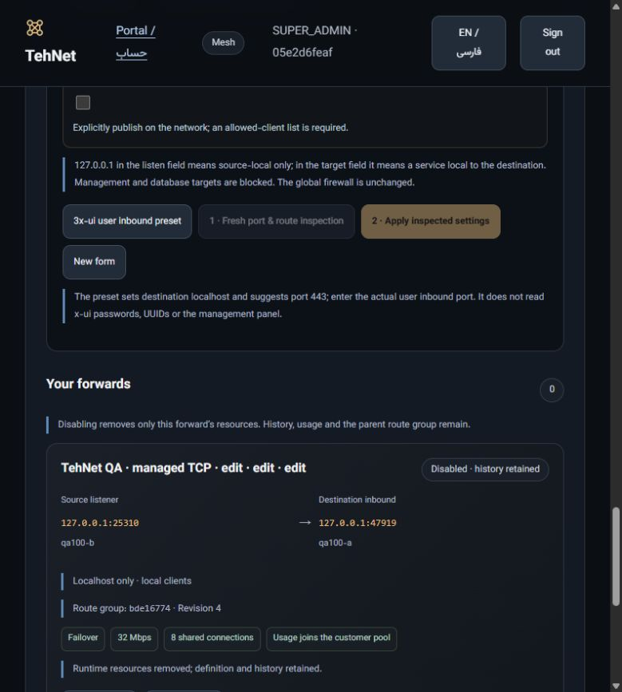
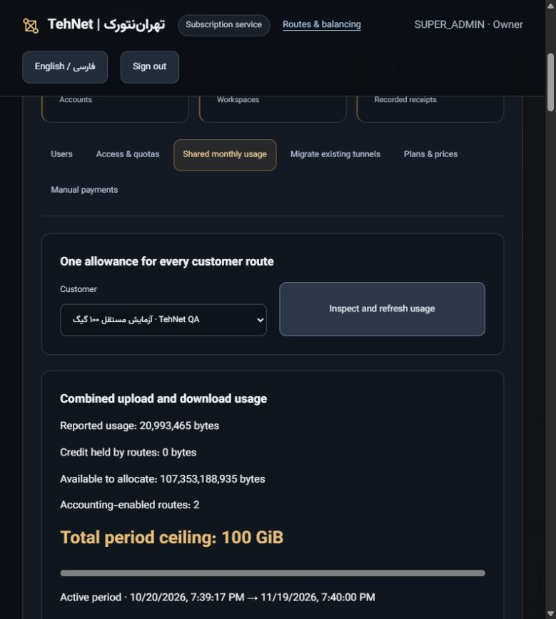

# Managed TCP services — installed

[فارسی](MANAGED-TCP-SERVICES-fa.md) · [Panel](https://tehnet.ir/tunnels/portal) · [Machine-readable acceptance](evidence/commercial/managed-services-installed.json)

Both execution APIs and the separate website container run **e7d79cc8f6b136328dcc2cc497b13d366bbb6d4a**, tree **8ac2b8a08d9759c08f621bfb14a2a103b038a291**. The website serves static files and proxies requests; tunnel traffic, SSH inspection, workers, customer databases and accounting stay on the execution nodes. This adds a fixed TCP port forward through an existing customer's route group. It does not install a second accounting gateway.

## Use the panel

1. Sign in with your assigned username/password at the Portal. Open **Tunnels & balancing → Port forwards**. The system owner sees the system workspace; sign in as a customer to manage that customer's existing groups. An owner manages customer allowances in the Portal.
2. Select a ready, observed route group. Customer groups must already use shared accounting. Historical unmetered groups require the explicit [administrator migration](ADMIN-MIGRATION.md), which preserves their settings. Creating a forward never silently migrates or restarts a parent group.
3. Enter a name, source listen address and free source port (1024–65535), then the destination service's literal IP and inbound port. `127.0.0.1` means the source node in the listen field, and the destination node in the target field. The 3x-ui preset suggests destination localhost:443; replace it with the actual **user inbound**, not the management panel. No x-ui password or UUID is read.
4. Keep localhost binding for private access. For network publication, explicitly acknowledge publication and supply allowed-client CIDRs. Global firewall rules are unchanged. Management/database targets and occupied/protected ports are refused.
5. Run **Fresh port & route inspection**, review the result, then **Apply inspected settings**. Changing an input invalidates the proof. Check status for a fresh worker/listener observation. This checks a listener, not application health or an SLA.
6. **Edit** applies a checked new revision with a private recovery checkpoint. Only that forward briefly reconnects; parent gateway and tunnel members remain running. **Inspect & recover** is available when an operation needs recovery. **Disable & remove forward resources** removes its owned runtime resources while retaining definition, history, usage and parent group. A stopped entry offers **Create similar**; it does not silently restart.

The parent applies rate, shared connection limits, failover/connection sharing and the customer's shared usage allowance. Existing TCP sessions reconnect after failure; multiple tunnels do not bond a single TCP stream. This feature forwards TCP only.

The actual customer UI retained two ready parent routes and two stopped revision-4 forward records. Create similar filled a new form with Apply disabled until a new inspection; nothing was submitted. Persian/English mobile checks had client width 360 and scroll width 360; the viewport was reset. [Photograph hashes and scope](evidence/commercial/managed-services-screenshots.json).

## Allowance and payment

Open **Portal → Users & sales administration → Shared monthly usage**, select the customer and inspect usage. Increase the total ceiling with **New period off** to preserve usage. A new period is a separate explicit administrator action. Manual payment recording/activation remains separate; no online payment provider was added. The retained QA customer's internal test grant is not evidence of a paid sale.

## Actual two-node acceptance

On the same two test servers, two independent localhost forwards used the retained, accounted 4in6 groups with 32 Mbps and eight shared connections. Four simultaneous direct/forward 1 MiB responses had verified hashes and a **single 4,195,048-byte debit**, including accepted request/response bytes. Another such round observed Linux TIME_WAIT before both actual API edits; both reached revision 4 in 21.157 seconds total. Forward-only service restarts preserved parent PIDs, settings and usage.

A temporary shared ceiling of **20,992,549 bytes** was reached exactly. All four subsequent direct/forward requests delivered zero headers/body; then **100 GiB = 107,374,182,400 bytes** was restored in the same period without clearing usage. Four fresh successful nonce responses added exactly 916 bytes. Final observed usage was **20,993,465 bytes**, held credit zero. This was an exhaustion test with a small temporary ceiling, not a 100 GiB transfer.

All ten original tunnel members and their two stable entries returned fresh nonce receipts. Both hosts retained 28 original active services with start timestamps preceding the rollout; original and retained QA parent configurations, credentials, PIDs and interfaces passed preservation checks. Twelve installed coexistence canaries passed per host. Only the two new forwards and their two synthetic origins were stopped; history and the two retained QA parent routes remain.

## Reproduced failures and fixes

The first physical run found the official root-owned `0640` environment file was rejected by a `0600` private-file reader. Only non-writable, root-owned regular environment reads used for management-port extraction were relaxed; private configs/certificates/keys remain `0600`. A real POSIX regression rejects writable environment files.

The first real forward edit exposed `EADDRINUSE` after server-first FIN/TIME_WAIT. POSIX listeners now use `SO_REUSEADDR`; `SO_REUSEPORT` stays off and foreign-listener refusal remains tested. A separate strict-umask `077` canary exposed unreadable newly created code paths for DynamicUser. Only newly created owned public code directories/files receive the required mode. Private files and existing directories are not broadened. Real socket regressions failed before the fixes; actual two-node traffic/edit/restart checks then passed. Initial failures remain in private audit records.

One exhaustion harness read a stale non-idle status sample; its finally block restored 100 GiB. The harness was corrected to await a fresh idle sample and the complete exhaustion/block/restore cycle passed. No result or usage history was erased.

## Verification and recovery scope

Exact functional CI: [portable/lifecycle](https://github.com/DashSaman/TunnelPannel/actions/runs/39676022496) and [security](https://github.com/DashSaman/TunnelPannel/actions/runs/39676022423), both successful. Python 3.12: 972 root, 100 TunnelGuard and one backend test passed; install/idempotence/backup/restore/uninstall passed. Local socket failover tests passed six checks; no original live tunnel was fault-injected.

Fresh before, immediate-preinstall and after rescues were encrypted and decrypt/SHA verified on **each original host**, with independent root-only keys held separately. Source certificates/checkpoint histories and their recovery keys have an additional final resident encrypted rescue. No database, environment or installation key was exported. Website cutover preserved 11 other containers, 50 links, five service PIDs and nginx/WordPress configuration; only the owned web container was replaced. Main is unmerged; work is recorded in [PR #2](https://github.com/DashSaman/TunnelPannel/pull/2).

These are receipts for two datacenter hosts, not Iran-path or geographic redundancy evidence. Private files and null worker stdout/stderr reduce exposure; root on an execution server can still inspect its runtime. Source-copy prevention or zero footprint is not guaranteed.
