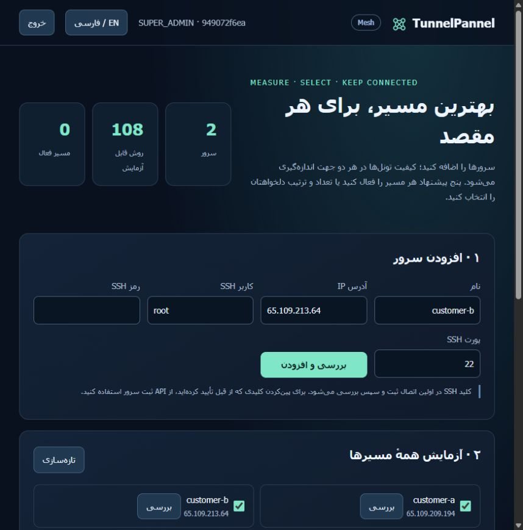
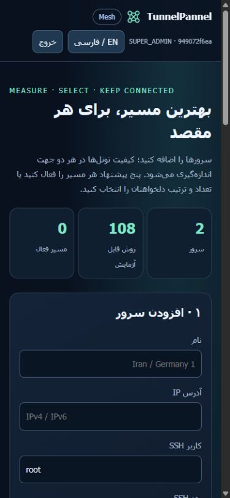

# Customer workspaces and directed tunnel testing

[فارسی](MESH-fa.md) · [Source inventory](MESH-SOURCES.md) · [Engine licenses](../THIRD_PARTY_NOTICES.md)

Open `/mesh` after installing. The catalog contains 108 identities: 91 profiles and 17 supported compositions across 21 technology families. Six compatibility aliases are additional names, not additional methods. Availability and successful measurements depend on the actual endpoints. Historical 82-method results remain in the RC3 report; an implementation count is not a passing-test count.

## Use the panel

1. Sign in with your workspace API key. It stays in page memory; reloading requires signing in again. The language button switches Persian/English and RTL/LTR.
2. Add each server's name, public IP, SSH user, password and port. The form clears the password after registration. The first observed SSH host key is recorded, then checked on subsequent connections. Use the node-registration API with an independently verified fingerprint when first-contact verification is required. The **Inspect** button refreshes capabilities.
3. Select servers. With N distinct physical servers the campaign measures N×(N−1) directed routes. Select all methods, the five-method starter set, or explicit methods. Choose NORMAL or DEEP and the requested recommendation count. **Start measurements** runs actual paired deployments; **Cancel** cleans the current owned deployment. History and **View** reopen progress and receipts. Physical-host mutations are serialized across customers to prevent overlapping network changes.
4. Each directed route displays latency, jitter, application request loss, throughput, recovery, score and status. Recommendations require successful setup, traffic, recovery and cleanup receipts. Distinct outer carriers are preferred before remaining quality rank. Fewer qualified choices remain fewer; results are never padded to five. The persistent-egress workflow filters out profiles without a TCP egress adapter.
5. Accept the suggested choices or select and order your own qualified methods. Counts above five work within the workspace limit. **Save selection** persists the order; **Deploy** creates the warm members and a stable authenticated SOCKS entry on the source server's loopback address.
6. Each destination group has its own entry and health state. **Refresh health** reads the independent systemd worker. **Outbound** reveals credentials to OPERATOR/SUPER_ADMIN. **Pin** temporarily chooses a healthy member; clearing the pin restores automatic selection. The advanced ordered member list and **Reconcile** add/remove qualified methods from that original route while retaining the entry port and credentials. **Stop** removes that group's owned resources.

New TCP connections move to another healthy member after the health threshold. Existing TCP sessions reconnect. Defaults use a two-second interval, five-second probe timeout and three failures, with hold-down to avoid rapid switching. Five warm members consume more memory and services than one. Multiple destination groups coexist; clients choose the appropriate group's outbound. Five protocols to one destination do not survive that destination's complete outage. The implementation does not replace the host's default route or turn SOCKS forwarding into a system-wide VPN.

Choose **Share connections by quality** in an active group's **Connection mode** selector, then **Apply mode and preference**, to distribute concurrent connections. Measured throughput, request loss and jitter establish bounded weights. Current nonce-probe delay, jitter and failures reduce a degraded member's effective weight. Weighted least-active-connection selection reserves capacity during connection setup and releases it when the stream ends; unhealthy members are excluded. A healthy manual pin takes precedence. The UI shows active and total connections per member. Switching modes keeps the entry port, credentials and established connections.

This shares separate TCP connections. A single TCP stream is not striped or bonded across tunnels. Aggregate capacity still depends on endpoint bandwidth, CPU and shared physical bottlenecks; more tunnels do not guarantee more speed. The release evidence records actual concurrent-transfer throughput and integrity checks. API clients can create a route with `mode: "balance"` or send `{"mode":"balance"}` to `PUT /api/mesh/routes/{id}/policy`; `failover` restores preference-based routing. Omitting `pin` preserves an existing pin, while an explicit null clears it.

Managed hosts retain root-owned reservation books in `/var/lib/tunnelpannel-engine-reservations`. Ports, inner prefixes, SSH interfaces and XFRM/VTI identifiers remain reserved while a warm member is stopped. The deployment journal removes its book during owned cleanup. Corrupt or unsafe books block new allocations. Physical-host leases coordinate customer workspaces in one panel installation; independent panel installations must not concurrently manage the same host.

When logical groups use keyless GRE, IP6GRE, IPIP or SIT between the same outer endpoints, they share one owned kernel carrier. Each member retains its own inner address, peer route, service and durable reference. Host-side locking serializes starts/stops, and only the last reference removes the carrier. Foreign matching interfaces are rejected before mutation. L2 GRE uses separately reserved keys. This follows Linux's [outer-endpoint/key tunnel lookup](https://github.com/torvalds/linux/blob/master/net/ipv4/ip_tunnel.c); creating differently named keyless interfaces does not establish separate receive paths. Shared carriers are not additional physical failure domains.





Protection depends on the selected protocol. GRE, IPIP, SIT and VXLAN add encapsulation without encryption. Use WireGuard, an authenticated TLS profile or a supported encrypted composition when confidentiality is required. Quality rankings measure connectivity and performance; they do not assign an encryption level.

## Interpreting metrics

HTTP latency uses the remote curl network timer, excluding the SSH command's round trip. Jitter is the mean absolute difference between successive measurements. Request loss measures failed application probes; UDP echo and ICMP measurements have their own bases. Speed is measured on owned traffic. Compare the measurement basis and profile before comparing scores. CPU and RAM describe the whole server.

NORMAL and DEEP include actual traffic and restart recovery. Source compilation is a dependency preparation phase before timed candidates. WaterWall-H is built from a pinned source commit as an unprivileged build user; a small server can spend several minutes compiling it. Compositions are explicit supported overlay/carrier templates. They must lose traffic when their actual carrier is stopped and recover after restoration. An arbitrary combination of two protocol names is not a supported composition.

The two validation endpoints are nearby Ubuntu 24.04 amd64 machines. Their results establish behavior on that pair. Iran paths, intercontinental performance, NAT traversal and larger physical graphs need measurements on those actual endpoints.

## Owner controls and future billing

The installation's SUPER_ADMIN token can create a workspace with `POST /api/workspaces` and list it with `GET /api/workspaces`. Creation returns the workspace API key once. Store it privately. A customer key cannot use the owner registry even though the customer can administer its own workspace.

`PATCH /api/workspaces/{id}` changes name, enabled state or limits; `POST /api/workspaces/{id}/rotate-key` invalidates the old key and returns the replacement once. `POST /api/workspaces/{id}/disable` blocks future API access. Disabling API access does not stop already deployed systemd routes; stop those routes explicitly when that is your product policy.

| Limit | Default |
|---|---:|
| Registered nodes | 12 |
| Members per destination group | 10 |
| Methods per campaign | 160 |
| Active campaigns | 1 |
| Active destination groups | 24 |

Each customer has a separate SQLite database and hashed API key; SSH credentials and route runtime credentials are encrypted with the installation key. Jobs retain the initiating workspace when running in background threads. Private/reserved customer SSH targets are rejected. Existing installation role tokens address the owner/system workspace.

These APIs provide isolation and configurable entitlements for a later commercial site. Payment collection, account signup, subscription webhooks, a public domain and TLS ingress are separate integrations. The installer keeps the API on loopback; use an SSH forward for administration or configure an authenticated TLS ingress for your own customer service.

## Backup, restore and maintenance

The canonical backup command includes an online SQLite copy of the owner database, the workspace registry and every customer database, plus a SHA-256 manifest. It contains hashed API keys and encrypted credentials. It excludes the installation encryption key and environment file. Keep `/etc/tunnelpannel/tunnelpannel.env` privately and separately: without the matching key, restored credentials cannot be decrypted.

```sh
sudo bash /opt/tunnelpannel/scripts/backup.sh /private/path/panel.tar.gz
sudo env RESTORE_TUNNELPANNEL=YES_I_UNDERSTAND bash /opt/tunnelpannel/scripts/restore.sh /private/path/panel.tar.gz
```

Restore validates the workspace snapshot before stopping the API and retains a safety copy of existing workspace storage. It replaces the database state. The installation uses systemd, Python 3.10+, and package paths for apt/dnf/yum/zypper/pacman/apk. Actual installation evidence is limited to the tested Ubuntu machines; those package paths do not establish equivalent results on every distribution. OpenRC-only hosts are rejected because the tunnel lifecycle uses systemd.

The API's `/health`, the route observation endpoints and the ownership ledger serve different purposes: application liveness, actual gateway health and resource cleanup. A listening process alone never qualifies a recommendation. Retained failed attempts remain part of the validation history.
