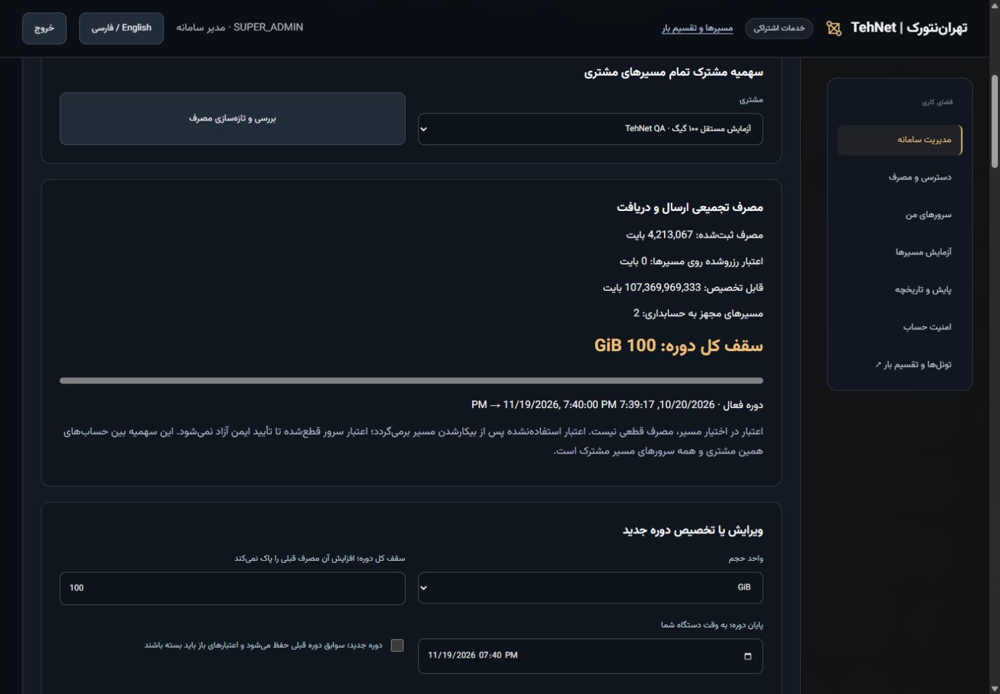

# مشتری واقعی با ۱۰۰ GiB، مهاجرت و ظاهر تازهٔ تهران‌نتورک

[English](QA-100GIB.md) · [ورود به پنل نصب‌شده](https://tehnet.ir/tunnels/portal) · [شواهد قابل بررسی](evidence/commercial/demo100/installed.json)

این آزمون در **۲۰ اکتبر ۲۰۲۶** برای یک **مشتری تازه با فضای مستقل** روی همان دو سرور مجاز اجرا شد. دو تونل همین مشتری برای بررسی مدیر روشن مانده‌اند. تونل‌های اصلی دوباره مهاجرت، بازسازی، ری‌استارت یا محدود نشدند. سرور سایت فقط کانتینر مستقل رابط و پروکسی را اجرا می‌کند؛ API، دیتابیس مشتری، صف، بنچمارک و تونل روی سرورهای اجرایی‌اند.

## مراحل انجام‌شده و روش تکرار برای مشتری

۱. با نام کاربری و رمز مدیر سامانه وارد شوید. در **مدیریت کاربران و فروش ← کاربران** نوع حساب را «مشتری با فضای مستقل» بگذارید؛ نام، نام کاربری یکتا و رمز خصوصی حداقل ۱۲ نویسه را وارد و حساب را بسازید. چند حسابِ یک فضای مشتری، سهمیه مشترک دارند؛ برای مصرف مستقل، فضای مستقل بسازید. رمز و کلید API را در عکس یا ریپو قرار ندهید.

۲. برای فروش عادی، در **پلن‌ها و قیمت** تعرفه را مشخص و در **پرداخت‌های دستی** دریافت وجه واقعی را ثبت کنید. برای آزمایش داخلی مشتری تازه، در **دسترسی و سهمیه ← دسترسی آزمایشی داخلی؛ بدون دریافت وجه** دلیل و مهلت ۱ تا ۷ روز را وارد و **فعال‌سازی تست بدون پرداخت** را بزنید. این دسترسی یک‌باره، ثبت‌شده و فقط در اختیار مدیر سامانه است؛ محدودیت Starter دارد، رسید مالی نمی‌سازد و خودکار تمدید نمی‌شود. اشتراک قبلی را جایگزین نمی‌کند و تکرار همان درخواست تاریخ پایان را جلو نمی‌برد. دسترسی مشتریان دیگر تغییر نمی‌کند.

۳. با حساب مشتری دو سرور را با اثر انگشت تأییدشده ثبت و آزمایش را اجرا کنید. این بار **NORMAL / IP4IN6 در هر دو جهت** واقعاً اجرا شد؛ سپس یک مسیر پایدار در هر جهت، **پیش از تعریف سهمیه مشترک** ساخته شد تا دو مسیر واقعاً فاقد حسابداری برای آزمون مهاجرت داشته باشیم. نتیجه قدیمی یا تونل اصلی جایگزین تست تازه نشد.

۴. با حساب مدیر در **مهاجرت تونل‌های قدیمی** همین مشتری را انتخاب کنید. هر مسیر قدیمی فعال را **پیش‌بررسی و آماده‌سازی** و سپس با مجوز تازه **مهاجرت با حفظ تنظیمات** کنید. منتظر «مهاجرت موفق» بمانید و بعد مسیر بعدی را انجام دهید. مسیرهای اصلی که حسابداری دارند دوباره مهاجرت نمی‌شوند. پیش از اولین سقف واقعی، همه مسیرهای قدیمیِ قابل مهاجرت همان مشتری را منتقل کنید؛ کنترل پوشش ناقص همچنان فعال است.

۵. در **مصرف مشترک ماهانه** همین مشتری را انتخاب کنید. **واحد حجم = GiB** و **سقف کل دوره = 100** بگذارید، پایان دوره را تعیین و گزینهٔ **دوره جدید را خاموش نگه دارید**؛ سپس **ثبت سهمیه مشتری** را بزنید. این کار واقعاً **۱۰۷٬۳۷۴٬۱۸۲٬۴۰۰ بایت به عنوان سقف کل** ذخیره می‌کند و مصرف قبلی و همان دوره را نگه می‌دارد. ۱۰۰ GiB به سقف قبلی اضافه نمی‌شود و پرداختی هم فعال نمی‌شود.

۶. با حساب مشتری بخش **دسترسی و مصرف** و **تونل‌ها و تقسیم بار** را ببینید. مشتری فقط مصرف و مسیرهای خودش را می‌بیند؛ APIهای مدیر برای سهمیه، مهاجرت و دسترسی آزمایشی را نمی‌تواند استفاده کند. مدیر می‌تواند سقف یا پایان را ویرایش کند یا پس از بسته‌شدن ایمن اعتبارهای باز، صریحاً دوره جدید بسازد. بازنشانی خودکار ماهانه وجود ندارد.

## نتیجه واقعی روی دو سرور

نسخه نصب‌شدهٔ **هر دو API و سایت**: `83335745ad3e2a75a8c13c43026801c18729c2bc`؛ درخت `2e83a55ca3e50a2efc9c05c79f391be350787e4e`. [CI تست‌ها](https://github.com/DashSaman/TunnelPannel/actions/runs/39453399733) و [CI امنیت](https://github.com/DashSaman/TunnelPannel/actions/runs/39453399728) پیش از نصب موفق شدند. نتیجه مشاهده‌شده Python3.12: **۸۴۶ تست اصلی + ۱۰۰ TunnelGuard + یک backend**؛ نصب، تکرار نصب، بازیابی و حذف ایمن لینوکس هم موفق بود. ویندوز: **۸۱۳ موفق / ۳۳ تست مخصوص POSIX ردشده از اجرا**. تست بسته‌ساز ابتدا نبود فایل پوسته را بازتولید کرد و بعد از اصلاح، ۱۴ تست مرتبط موفق شدند.

| بررسی | نتیجه مشاهده‌شده |
|---|---|
| بنچمارک تازهٔ 4in6 در دو جهت | هر دو موفق؛ ۳۰ نمونه HTTP بدون درخواست ناموفق، انتقال واقعی iperf3 در دو جهت و بازیابی مسیر |
| میانگین تأخیر HTTP و جیتر | ۱٫۹۴۷ / ۰٫۵۱۰ و ۱٫۹۶۵ / ۰٫۶۸۵ میلی‌ثانیه |
| ظرفیت محافظه‌کارانه ثبت‌شده برای دو آزمایش | ۱۴۵۳٫۶۲ و ۱۶۱۰٫۸۱ مگابیت؛ اندازه‌گیری مرکز داده پیش از سیاست ۳۲ مگابیت مسیر QA |
| مهاجرت از دکمه‌های واقعی مدیر | مبدأ اول ۳۰ پاسخ موفق و ۵ ناموفق؛ مبدأ دوم ۳۴ و ۵؛ بیشترین فاصله پاسخ موفق ۰٫۹۲۷ و ۰٫۹۳۵ ثانیه |
| حفظ تنظیمات در مهاجرت | ورودی، تنظیمات و رابط‌ها حفظ شدند؛ تعداد ری‌استارت عضو زیرین صفر؛ بکاپ رمزگذاری‌شده کنترلر تأیید؛ مبنای مصرف قبلی هر مسیر ۸۹۷ بایت |
| تخصیص واقعی اولیه | ۱۰۰ GiB در همان دوره با حفظ ۱۷٬۹۴۰ بایت مصرف |
| انتقال کوچک واقعی | بدنهٔ ۱ MiB با تطبیق SHA در هر مبدأ؛ مجموع ثبت‌شده ۲٬۱۱۵٬۴۵۲ بایت و اعتبار باز صفر؛ با شمارنده دو مبدأ پس از کسر مبنای معلوم برابر |
| ری‌استارت آزمایشی | فقط دو دروازه QA ری‌استارت شدند؛ شمارنده و مصرف مشترک باقی ماند؛ پردازش اصلی دست نخورد |
| آزمایش سقف مشترک دقیق | فقط سقف همین مشتری موقتاً **۴٬۲۱۲٬۶۲۱ بایت** شد؛ برابر مصرف قبلی + ۲ MiB + ۱۷ بایت. درخواست‌های هم‌زمان ۲۰ MiB دقیقاً در سقف مجموع متوقف شدند؛ یک مسیر پیشوند تأییدشده گرفت و دیگری صفر؛ اعتبار باز صفر |
| درخواست بعد از اتمام سهمیه | هر دو سرور **صفر بایت بدنه و صفر بایت هدر** گرفتند؛ شمارنده‌ها تغییر نکردند |
| بازگردانی | **۱۰۰ GiB در همان دوره** با حفظ مصرف و تمام سابقه؛ تبادل nonce واقعی دوباره از هر دو مبدأ موفق شد |
| وضعیت نهایی مشتری | **۴٬۲۱۳٬۰۶۷ بایت مصرف / صفر اعتبار باز / ۱۰۷٬۳۷۴٬۱۸۲٬۴۰۰ سقف / ۱۰۷٬۳۶۹٬۹۶۹٬۳۳۳ قابل تخصیص** |
| جداسازی و ورود | API مدیر برای مشتری403؛ درخواست مدیر با کوکی بدون CSRF403؛ برچسب «بدون دریافت وجه»؛ تعداد رسید مالی صفر |
| تونل‌های اصلی | ۱۰ رسید واقعی عضو و دو ورودی ثابت موفق؛ تنظیمات کامل، PID دروازه‌ها، هویت‌های ثبت‌شدهٔ اعضا، ifindex و payload حفظ شد؛ هر ۲۸ سرویس ثبت‌شده در هر نود پیش از شروع این ارتقا فعال شده بود |
| سیاست مشتری اصلی | همچنان بدون سقف و بدون پایان؛ کار تازه نیازمند پرداخت؛ پس از رسیدهای کنترل واقعی ۲۱٬۸۰۹ بایت مصرف و اعتبار باز صفر |
| جلوگیری از تداخل | هر ۱۲ بررسی canary در هر سرور موفق؛ فقط منابع همان canary پاک شدند |
| سایت | مقایسه تازه: ۱۱ کانتینر دیگر، ۵۰ رابط، PID پنج سرویس انتخاب‌شده و فایل‌های nginx ثابت؛ فقط کانتینر اختصاصی رابط تعویض شد؛ پروکسی میزبان reload نشد |
| پشتیبان | قبل، بلافاصله پیش از نصب با بستن پذیرش، و بعد: بکاپ canonical و شمارنده آنلاین و env جدا برای هر نصب؛ آرشیو رمزگذاری‌شده مستقل و کلید جدا با دسترسی0600 در هر نود و سایت؛ SHA محتوای رمزگشایی‌شده برابر |

**۱۰۰ GiB تخصیص داده شد؛ ۱۰۰ GiB ترافیک منتقل نشد.** سقف کوچک صرفاً آزمون کنترل‌شده بود. ترافیک بنچمارک قبل از حسابداری دروازه اجرا شد. شمارنده، payload پذیرفته‌شدهٔ تونل مدیریت‌شده شامل درخواست/هدر HTTP را می‌شمارد؛ مصرف نامعلوم قبلی را نمی‌سازد و معیار صورتحساب ISP یا حسابداری مقاوم در برابر root نیست.

## آنچه برای بررسی باقی مانده است

حساب مستقل و دو مسیر **UP / COMMITTED** همین مشتری نگه داشته شدند؛ فقط دو origin موقتِ انتقال تست پاک شدند: دو deployment و هشت تخصیص آزاد شد. شمارنده واقعی مبدأ، checkpoint مهاجرت و تمام سابقه سهمیه باقی است. دسترسی آزمایشی هفت‌روزه تا **۲۷ اکتبر ۲۰۲۶** است؛ زمان دقیق در پنل دیده می‌شود و توقف پس از انقضا فقط برای تونل‌های همین مشتری فعال است. پایان جداگانه سهمیه **۱۹ نوامبر ۲۰۲۶** دسترسی آزمایشی را تمدید نمی‌کند. اطلاعات ورود خصوصی تحویل می‌شود؛ در ریپو قرار ندارد. ورودی SOCKS رمزدار و فقط روی loopback است؛ پروکسی عمومی جدید باز نشده است.

ظاهر پورتال و صفحه مسیرها با زمینه زغالی، تأکید طلایی، تیتر و فاصله‌گذاری روشن‌تر، نمای مفهومی شبکه، راهبری کنار صفحه دسکتاپ، کارت‌های مدیریت و نمایش صریح سقف ۱۰۰ GiB بازطراحی شد؛ اعداد دقیق بایت حفظ شدند. نسخه فارسی و انگلیسی مدیر/مشتری روی سایت نصب‌شده بررسی شد. در آزمون موبایل375، عرض client/scroll هر دو زبان360/360 بود و اندازه مرورگر بازگردانده شد. فوکوس صفحه‌کلید در نمونه محلی بررسی شد؛ CSS کاهش حرکت وجود دارد ولی ترجیح سیستم‌عامل شبیه‌سازی نشد.

منابع پیشنهادی مالک: [Modulify](https://modulify.ai/templates)، [WeDoFlow](https://www.wedoflow.com)، [Landdding](https://landdding.com)، [Motion](https://www.motionin.design). از نظم، فاصله، کنتراست و حرکت محدود آن‌ها الهام گرفته شد؛ کد یا دارایی قالب تجاری کپی نشد. فونت [Vazirmatn](https://github.com/rastikerdar/vazirmatn) نسخه33.003 با [مجوز و سابقه منبع](third-party/Vazirmatn.json) روی خود سایت است؛ فونت CDN و JavaScript شخص ثالث لازم نیست.

این نتایج به معنی قطعی صفر، حفظ نشست TCP قبلی، افزایش سرعت تک‌دانلود، افزونگی جغرافیایی، کیفیت ایران یا SLA پیوسته نیست. بازیابی زندهٔ توزیع‌شده اجرا نشد. main در PR2 ادغام نشده؛ درگاه پرداخت آنلاین، SSO، دامنه یا حذف سرور اضافه نشد. تمام عکس‌های این صفحه از نسخه نصب‌شدهٔ همین سایت و همین اجرا هستند، نه نمونه محلی یا تصویر ساختگی.
