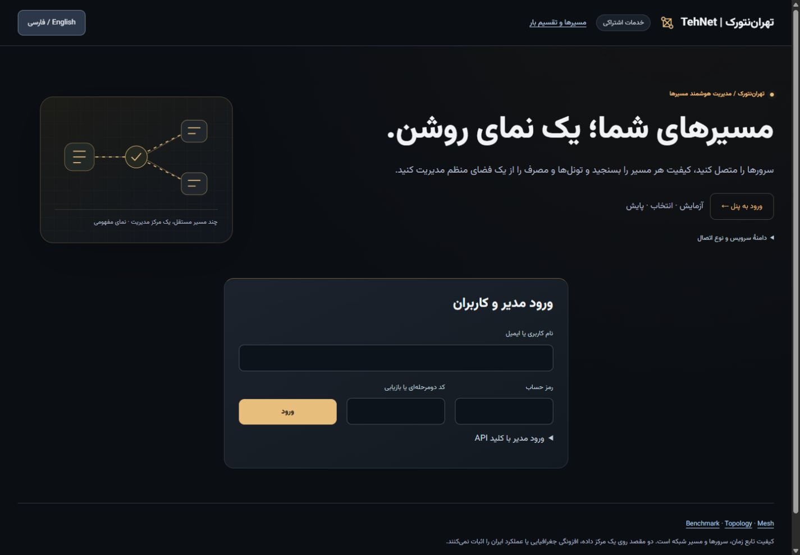
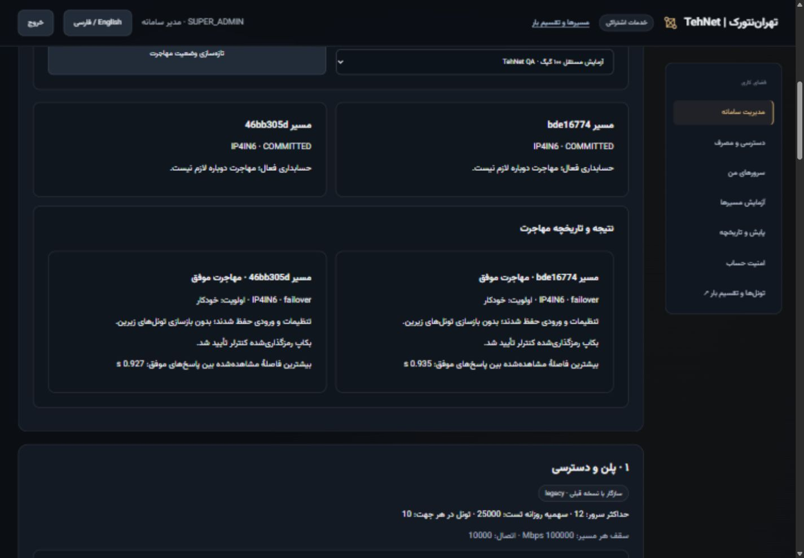
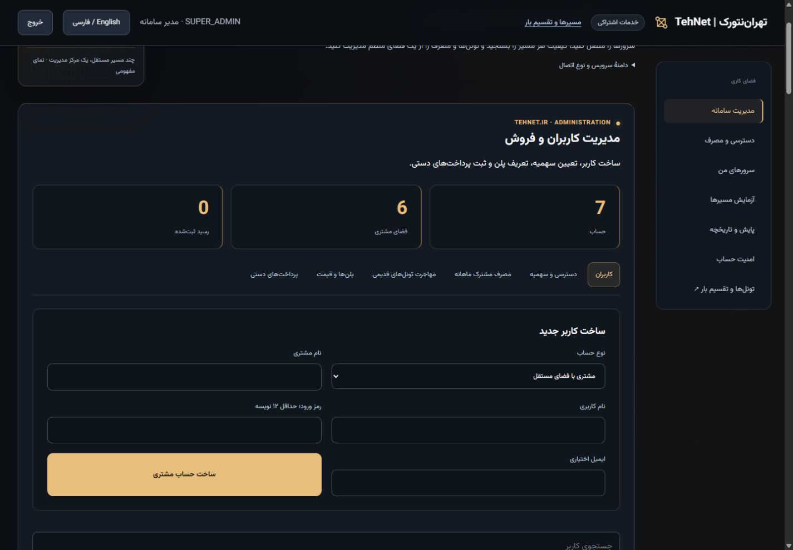
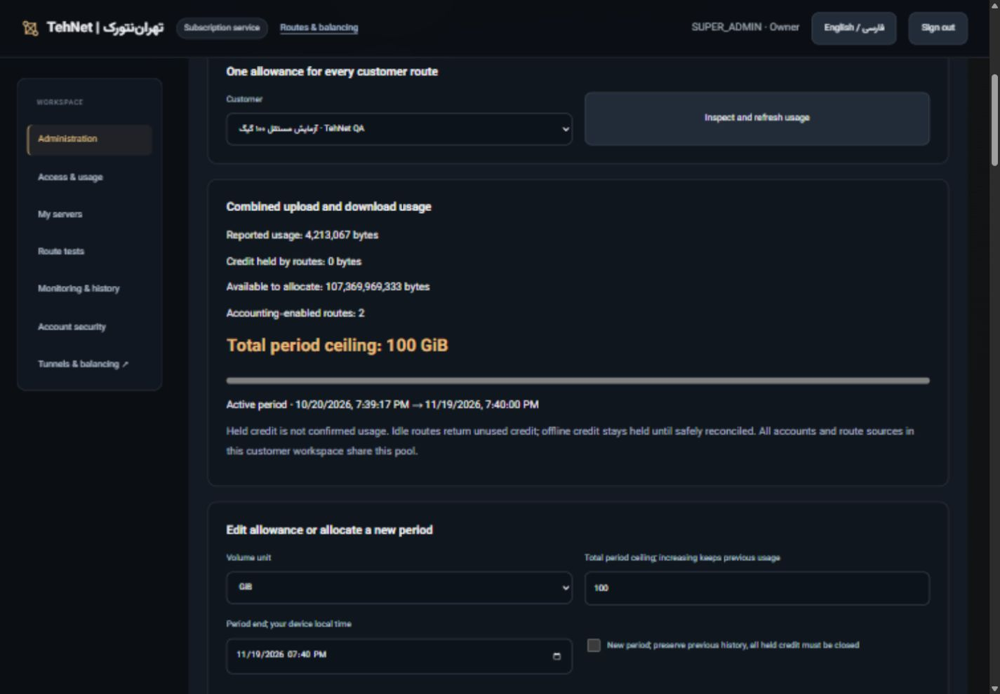
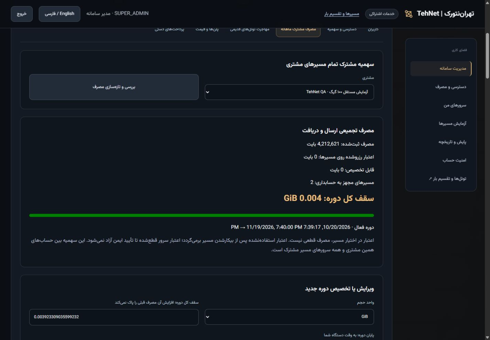
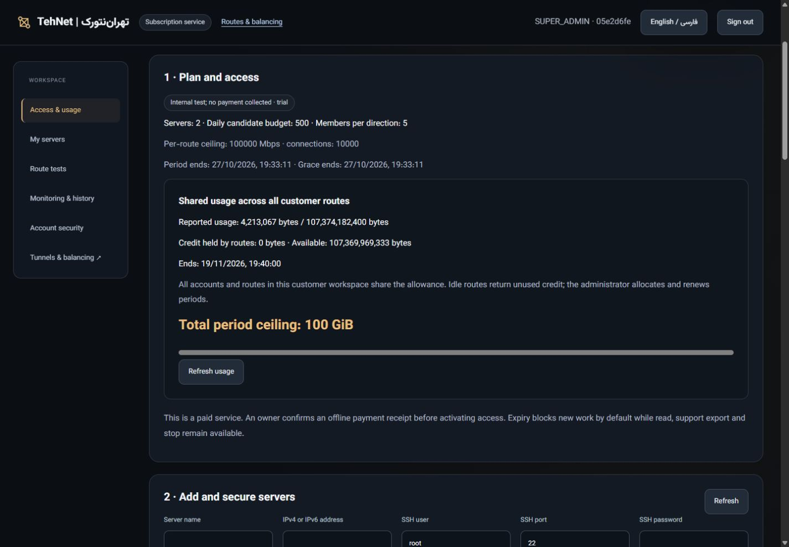
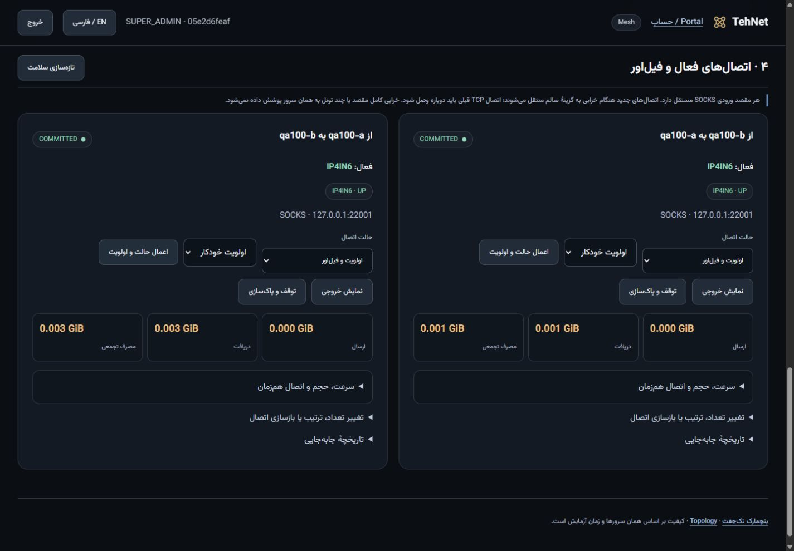
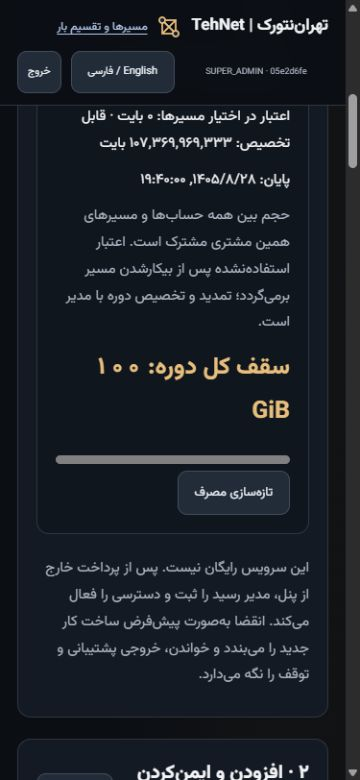

# A real 100 GiB customer, migration and refreshed TehNet console

[فارسی](QA-100GIB-fa.md) · [Open the installed panel](https://tehnet.ir/tunnels/portal) · [Machine-readable acceptance](evidence/commercial/demo100/installed.json)

The 2026-10-20 demonstration used a **new independent customer workspace** and the two authorized execution nodes. Both customer routes remain running for owner review. Original customer tunnels were neither migrated again nor restarted, capped or rebuilt. The website runs only its own static/proxy container; API, customer data, benchmarks and tunnels remain on execution servers.

## Repeat the workflow for a customer

1. Sign in with an existing system-owner username/password. Open **Administration → Users**, choose **Customer with an isolated workspace**, enter a unique username/name and private password of at least 12 characters, and create the account. Accounts sharing a workspace share its allowance; use separate customer workspaces for separate pools. Do not publish passwords or API keys in screenshots.
2. For normal sales, use the existing **Plans & prices** and **Manual payments** workflow to record an actual offline payment. For a genuinely internal new-customer test, open **Access & quotas → Internal test access; no payment collected**, enter a reason and 1–7 days, then **Activate test without payment**. This is one owner-only audited Starter grant, with no financial receipt or automatic renewal. It cannot replace any previous subscription or be replayed to extend expiry. Other unpaid customers remain blocked.
3. Sign in as the customer, register two authorized servers with verified SSH fingerprints, and run a campaign. The demonstration ran **NORMAL / IP4IN6 in both directions**, then created one persistent route per direction **before allocating a shared allowance**, producing two real legacy-style unmetered routes. No historical receipt or running original was reused.
4. As owner, open **Migrate existing tunnels**, select the new customer, and inspect each live legacy route. Click **Inspect and prepare** followed by **Migrate preserving settings**, using the fresh ticket. Wait for **Migration passed** before preparing the next route. Already-accounted originals show that repeat migration is unnecessary. Migrate all eligible legacy routes before assigning the first real ceiling; coverage guards remain enforced.
5. Open **Shared monthly usage**, select this customer, set **Volume unit = GiB**, **Total period ceiling = 100**, and choose an end. Leave **New period unchecked**, then **Save customer allowance**. This saves **107,374,182,400 bytes as the TOTAL ceiling**, preserving existing consumption and the period. It does not add 100 GiB on top of previous allowance or activate a payment.
6. Sign in as the customer and inspect **Access & usage** and **Tunnels & balancing**. The customer sees only its own allowance/routes and cannot enter owner migration, allowance or test-grant APIs. The owner can later adjust the ceiling/end or explicitly start a new period when held credit is safely closed. There is no automatic monthly reset.

## Actual two-node results

Installed API **and website** revision: `83335745ad3e2a75a8c13c43026801c18729c2bc`, tree `2e83a55ca3e50a2efc9c05c79f391be350787e4e`. Exact portable/security CI passed before installation: [portable](https://github.com/DashSaman/TunnelPannel/actions/runs/39453399733), [security](https://github.com/DashSaman/TunnelPannel/actions/runs/39453399728). Observed Python 3.12: **846 root + 100 TunnelGuard + 1 backend** tests passed; Linux installer/idempotence/restore/safe uninstall passed. Windows: **813 passed / 33 POSIX skips**; packager regression first failed on missing theme then passed with the font/theme included (14 focused tests).

| Check | Observed result |
|---|---|
| Fresh native4in6 campaign, A→B / B→A | Both PASS; each 30 HTTP samples, zero failed requests; recovery and bidirectional iperf3 verified |
| HTTP average RTT / jitter | 1.947 / 0.510 ms; 1.965 / 0.685 ms |
| Recorded conservative throughput per campaign direction | 1453.62 / 1610.81 Mbps; datacenter measurement before the QA route's 32 Mbps policy |
| Owner-browser migration A / B | 30 successes + 5 failures / 34 + 5; maximum observed success gaps 0.927 / 0.935 s |
| Migration preservation | Entry/settings and interfaces retained; zero underlying-member restarts; encrypted controller checkpoint verified; each known pre-cutover source baseline = 897 bytes |
| Saved customer allowance | 100 GiB, same period, existing 17,940 bytes retained |
| Real small transfer | Full SHA-verified 1 MiB body on each source; pool reached 2,115,452 bytes, held 0; sum of source counters minus known baselines matched |
| QA gateway-only restart | Both QA workers restarted; all real counters and pooled usage retained; original workers untouched |
| Exact shared-cap test | Temporarily changed ONLY this QA customer's total ceiling to **4,212,621 bytes** (= used + 2 MiB + 17). Concurrent 20 MiB requests stopped exactly at the combined ceiling; one route received a verified prefix, the other no payload; held 0 |
| Exhausted follow-up | A and B each received **0 body / 0 header bytes**, counters unchanged |
| Restore | Restored **100 GiB in the SAME period**, retaining all usage/history; new verified nonce transfers succeeded on BOTH sources |
| Final retained pool | **4,213,067 used / 0 held / 107,374,182,400 total / 107,369,969,333 available bytes** |
| Isolation/security | Customer owner namespaces 403; owner cookie mutation without CSRF 403; trial clearly marked no payment; zero manual payment receipts |
| Originals | 10 member + 2 stable-entry nonce receipts PASS; full original configs/gateway PIDs/recorded member identities/link indices/job payloads preserved; all 28 recorded services per node started before rollout |
| Original customer policy | Still unlimited, no end/cap, pending payment for new work; 21,809 actual bytes after fresh verification receipts, held 0 |
| Coexistence | 12 canary checks EACH node PASS; only owned canary resources removed |
| Website | Fresh comparison: 11 unrelated containers, 50 links, 5 selected service PIDs and nginx files unchanged; only own static container replaced; no host proxy reload |
| Recovery material | Fresh before/frozen-immediate-preinstall/after canonical and online source-usage backups + separate environment EACH node; independent resident encrypted rescues and separate root0600 keys EACH node + website, decrypted SHA equality verified |

The small ceiling was an explicit bounded test: **100 GiB was allocated, not transferred**. Benchmark traffic preceded managed-gateway accounting. The retained pool counts accepted managed TCP payload, including HTTP request/response headers; it does not retroactively invent benchmark/pre-migration usage, measure ISP billing, or resist a hostile root administrator.

## Retained resources and visual changes

The independent test account and two **UP, COMMITTED** IP4IN6 routes remain available for review; only the two expendable payload origins were removed (2 deployments, 8 allocations released). Real source ledgers, migration checkpoints and all allowance history remain. Internal access lasts seven days (until **2026-10-27**, exact time shown in the panel), with only this customer's owned routes set to stop after expiry. The allowance's separate end is **2026-11-19**; that date does not extend access. Credentials are delivered privately, never in this repository. SOCKS entries remain authenticated and loopback-bound; the demonstration adds no public proxy listener.

The portal and route workspace now use original charcoal/gold surfaces, stronger hierarchy, a schematic hero, desktop workspace navigation, clearer owner cards and an explicit 100 GiB meter alongside exact byte counters. Persian/English customer and owner views were checked on the installed site; mobile override375 reported client/scroll360/360 in both languages and was reset. Keyboard focus was checked locally. Reduced-motion CSS is included; OS preference emulation was not performed.

References supplied by the owner: [Modulify](https://modulify.ai/templates), [WeDoFlow](https://www.wedoflow.com), [Landdding](https://landdding.com), [Motion](https://www.motionin.design). They informed hierarchy/spacing/contrast and restrained motion; no proprietary template code/assets were copied. [Vazirmatn](https://github.com/rastikerdar/vazirmatn) v33.003 is self-hosted with its [OFL notice/provenance](third-party/Vazirmatn.json); no CDN font or third-party JS request is required.

No zero-outage/old-TCP-survival, single-download bonding, geographic redundancy, Iran-route or continuous-SLA claim follows from these tests. No live distributed restore was performed. Main remains unmerged under PR2; no online payment gateway, SSO, domain or server deletion was added. All screenshots above are actual installed public-site captures from this run, not the local fixture or mockups.
