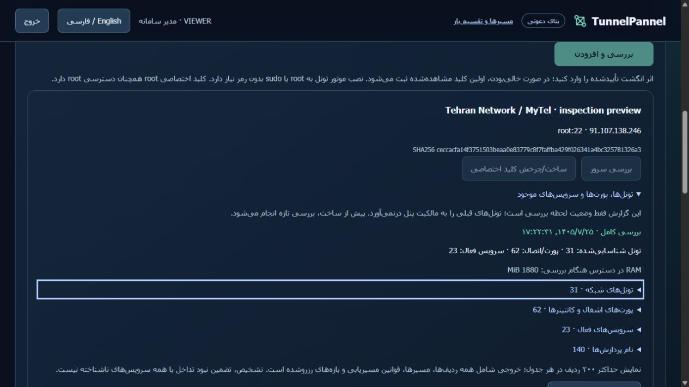
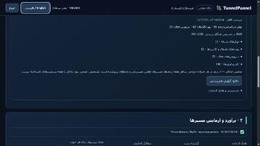

# وضعیت بررسی نسخهٔ هم‌زیستی — ۲۰۲۶/۱۰/۱۷

**طبق درخواست مالک، نصب روی سرورهای تست تا پایان آزمایش
`757cdb8cd8ff45afa05a55aa4395a919` به تعویق افتاد.** در این نقطه هر دو API هنوز
نسخه `c300a4a9b2036b9701c8dcebdcc9b3be06676f86` را اجرا می‌کنند. قابلیت جدید
منتشر و به‌صورت کاندید آزمایش شده است و نصب‌شده ادعا نمی‌شود. مقصد تهران‌نتورک/
مایتل فقط خوانده شد؛ سایت، کانتینرها، reverse proxy، پنل قدیمی و تونل‌های آن تغییر نکرد.

[راهنما، منابع و محدودیت‌ها](SHARED-HOST-fa.md) · [شواهد بدون اطلاعات دسترسی](evidence/commercial/coexistence-candidate.json).

| بررسی | نتیجه واقعی |
|---|---|
| نسخهٔ عملکردی دارای CI موفق | `98e2424dc1bdeb085688350304dee6fe3a751243` |
| CI اصلی | [39039167798](https://github.com/DashSaman/TunnelPannel/actions/runs/39039167798)، موفق |
| CI امنیت | [39039167803](https://github.com/DashSaman/TunnelPannel/actions/runs/39039167803)، موفق |
| هر یک از Python3.11 و3.12 | ۷۱۸ اصلی +۱۰۰ TunnelGuard +۱ backend موفق |
| نصب لینوکس | نصب تازه، تکرار، بکاپ/تغییر/بازیابی، حذف امن بدون دست‌زدن به منابع دیگر، syntax و ShellCheck موفق |
| ویندوز | ۶۹۶ موفق،۲۲ تست وابسته به پلتفرم اجرا نشد |
| آزمون canary واقعی | روی هر سرور تست۱۲ بررسی نام‌دار موفق |
| مبنای گروه‌های فعال | دو گروه/۱۰ عضو سالم؛ ورودی، روش، حالت و PID worker ثابت ماند |
| وضعیت مقصد مشترک | دو هسته،۳٫۷۳GiB RAM و حدود۱٫۸۴GiB در دسترس؛۱۰ کانتینر،۲۳ سرویس و۳۱ اینترفیس نوع تونل شامل پیش‌فرض کرنل |
| نگاشت واقعی کانتینر | سه پورت منتشرشده خوانده شد؛ کانتینر تغییر نکرد |
| UI | گزارش واقعی ذخیره‌شده در API محلی جدا؛ فارسی/انگلیسی، دانلود، موبایل۳۹۰px موفق؛ عرض۳۷۵ و محتوا۳۷۵؛ اندازه مرورگر بازگردانده شد |
| بازیابی | آرشیو هر دو سرور همراه env/کلید جدا روی کامپیوتر ذخیره شد؛ رمزگذاری/بازکردن DPAPI تطبیق داشت؛ همان حساب ویندوز/کامپیوتر لازم است |

مبنای۱۰ عضو، وضعیت فعلی قابل مشاهده مالک بود: گروه تاریخی۷ عضوی مبدأ از قبل
متوقف و یک گروه۵ عضوی failover جایگزین آن شده بود. گروه۵ عضوی balance جهت
برعکس باقی بود. هیچ گروه تاریخی بازسازی و هیچ رمز ورودی بازنشانی نشد.

CI اولیه39038813751 در هر نسخه Python،۷۱۷ موفق و یک شکست داشت؛ شبیه‌ساز محدود
تست POSIX رزرو، فرمان اسکن جدید را نمی‌شناخت. همان تست اکنون snapshot خالی و
مشخص را می‌دهد و تخصیص‌دهنده و رزرو پایدار واقعی را نگه می‌دارد. شکست اولیه حذف
نشده است؛ تست اصلاح‌شده روی سرور لینوکس واقعی و سپس هر دو مجموعه کامل CI گذشت.
تست نصب اولیه هم موفق بود.

تصاویر زیر **پیش‌نمایش محلی کاندید با گزارش واقعی ذخیره‌شده** هستند؛ نصب زنده
از آن‌ها استنتاج نمی‌شود. دیتابیس پیش‌نمایش رمز SSH و کارهای کپی‌شده ندارد و
فقط نقش مشاهده‌گر می‌دهد. معرفی پنل، آن را خدمت تهران‌نتورک نشان می‌دهد؛ SSO،
حساب مشترک WordPress، خرید واقعی و اتصال به سایت/reverse proxy هنوز انجام نشده‌اند.

تصاویر دیگر: [انگلیسی](evidence/commercial/screenshots/preview-en.png)،
[موبایل فارسی](evidence/commercial/screenshots/preview-mobile-fa.png)،
[موبایل انگلیسی](evidence/commercial/screenshots/preview-mobile-en.png).

پس از پایان آزمایش مالک: وضعیت همان لحظه گروه‌ها ثبت شود، بکاپ تازه گرفته شود،
نسخه ثابتِ تأییدشده نصب شود، canary و بررسی تازه و رسید واقعی ترافیک تأیید شود
و ورودی و worker همان گروه‌های فعلی حفظ شود. سپس شواهد نصب و نسخه بازیابی تازه
شوند. لغو آزمایش مالک، حذف سرورها، merge روی main یا انتقال مقصد مشترک جزو این
مرحله تعویقی نیست.
