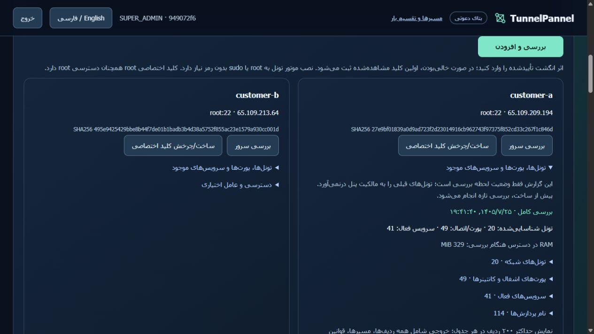

# Installed shared-host validation — 2026-10-17

Immutable runtime `8f1e425c38c76f8b1acb570a2392c060f7c3a5c1` is now installed on BOTH authorized test nodes. The owner's campaign finished before either API was restarted; every workspace's job queue on both nodes was checked empty. Only those two test installations were upgraded. The Tehran Network/MyTel host remains inspection-only.

[Usage and limits](SHARED-HOST.md) · [Installed evidence](evidence/commercial/coexistence-installed.json) · [Earlier candidate evidence](evidence/commercial/coexistence-candidate.json).

| Check | Observed result |
|---|---|
| Immutable revision portable CI | [39039902316](https://github.com/DashSaman/TunnelPannel/actions/runs/39039902316), SUCCESS rechecked before install |
| Security CI | [39039902280](https://github.com/DashSaman/TunnelPannel/actions/runs/39039902280), SUCCESS |
| Python3.11 and3.12, each | 718 canonical +100 TunnelGuard +1 backend PASS |
| Linux installer | Fresh/rerun, backup/mutate/restore, safe uninstall, syntax and ShellCheck PASS in CI |
| Installed identity and health | Independent encryption/RBAC hashes preserved, loopback HTTP health PASS on both |
| Installed canaries | 12 checks EACH node PASS; scoped cleanup, original tunnel links preserved |
| Fresh inventory | Controller20 links/49 bindings/41 services; peer20/34/38. Both complete, fresh SSH result equals cached authenticated no-store API |
| Existing active groups | Two groups/10 healthy members; entry hashes, ordered methods, failover/balance modes and gateway PIDs unchanged |
| Existing paired upstreams | 20/20 nonce HTTP receipts, two for each of10 methods in both directions |
| UI on installed controller | Persian/English report, JSON download and390px mobile PASS; document375/content375; viewport reset |
| Recovery | Fresh pre/post archives plus separate per-install env/keys; rescued privately and DPAPI encrypt/decrypt equality verified |

The current source group has5 methods in failover mode; reverse has5 in balance mode. The historical7-member group was already stopped by the owner before this work and was not recreated. The gateway worker PIDs remained1140595/873935. Existing upstream receipts prove bounded nonce transport through those warm tunnels, not bulk throughput, public exit identity or a continuous SLA.

The owner's complete campaign contains216 candidate results:215 PASS and one FAILED (`WATERWALL_H_HTTP2_TLS`, peer→controller). Setup and initial data-plane proof passed, but a later HTTP transfer closed with112bytes remaining (curl18). This historical failure is retained. A new installed one-method campaign `0400961401bf4d3b94f394a4951ee33d` passed BOTH directions with SHA256-verified transfer, latency/jitter samples, recovery and26 owned resources released per direction. Observed rates were300.73/290.18Mbps during10-second tests. The intermittent cause was not established; this retest is not presented as a permanent protocol fix or a guaranteed rate.

Pre-upgrade and final backups were each checksum verified and rescued with separate installation keys before/after rollout. Original snapshots remain. The new snapshots were not restored over live customer data; prior physical restore and immutable CI restore evidence remain the restore proof. DPAPI requires this Windows account/machine. A database backup does not replace deleted live endpoints.

The earlier candidate checks and local shared-host previews remain historical evidence, not live screenshots. The existing real container publications on the third host were read only; Docker NAT behavior was unit tested, not injected on these two Docker-free nodes. Initial functional CI717/1 failed because a narrow POSIX test fake did not recognize the inventory command; the corrected test passed physically and both full718 matrices passed.

Installed screenshots:

[English](evidence/commercial/screenshots/installed-en.png) · [Persian mobile](evidence/commercial/screenshots/installed-mobile-fa.png) · [English mobile](evidence/commercial/screenshots/installed-mobile-en.png).

This remains the Tehran Network private test service: no domain, checkout, WordPress/SSO integration, server deletion, shared-host migration or main merge. Sharing distributes new TCP connections; it does not bond a single download or provide full UDP/IP VPN. Inspection is conservative and cannot guarantee compatibility with every unknown service or future bind race.
