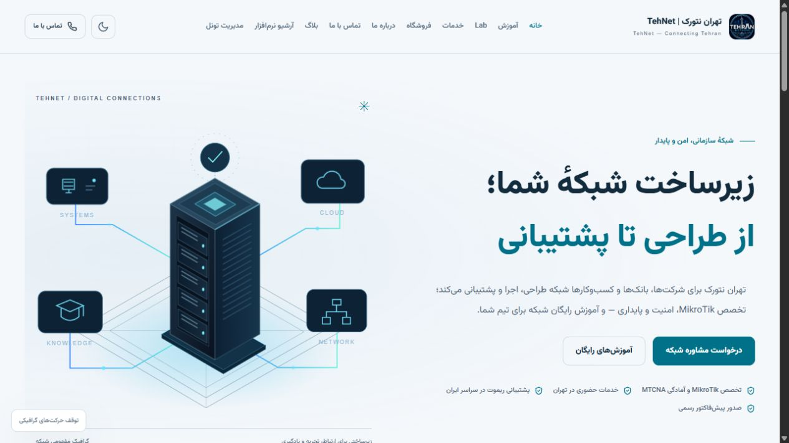
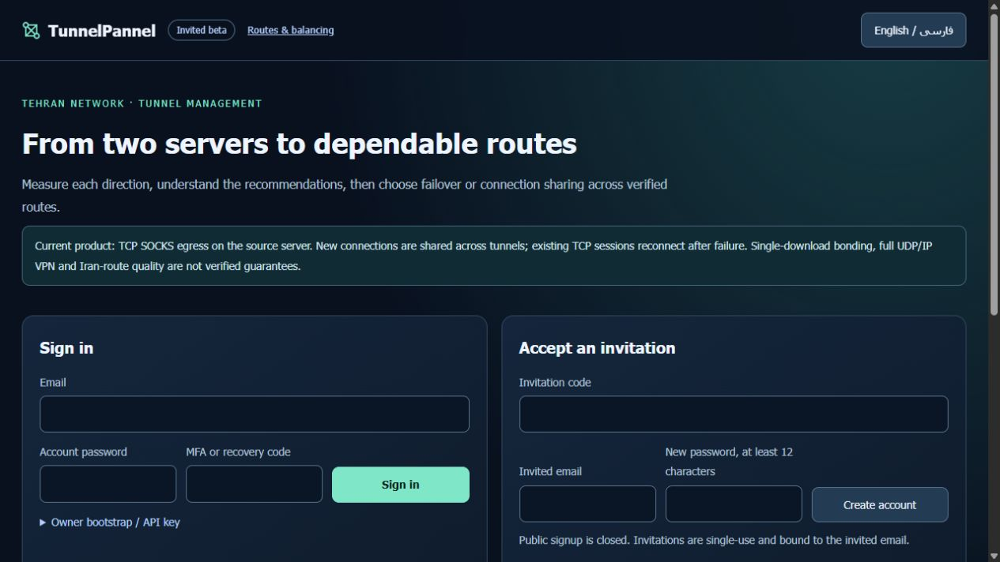
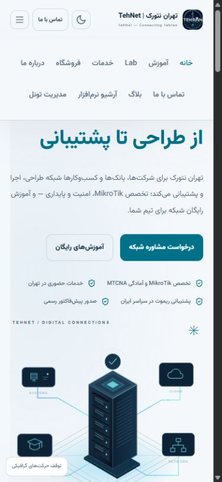

# Public Tehran Network container — installed validation

The owner-requested public panel is live at **https://tehnet.ir/tunnels/**.
WordPress primary desktop and mobile menus now include **مدیریت تونل**.
All nine prior menu entries retain their IDs, order, URLs and parents. No
WordPress account integration, public signup or real payment was enabled.

The dedicated `tunnelpannel-tehnet-web` container runs only static UI and nginx
proxying. API, customer databases, queues, quota checks, builds, benchmarking
and all tunnels remain on the separate execution nodes. The container uses
the digest-pinned nginx image recorded in the [allowlisted evidence](evidence/commercial/tehnet-public-installed.json),
UID101, read-only rootfs, no capabilities, no-new-privileges,96MiB,0.20CPU and
32 tasks. It has no SSH credential, database or Docker socket mount. Host
networking deliberately reaches the existing restricted loopback SSH forward;
this shares the host network namespace. Its own listener is loopback only.
The canonical port manager selected the port from a fresh complete inventory,
and it was rechecked before startup. [Reproduction/rollback design](TEHNET-CONTAINER.md).

Frontend source76c53947acef5e8192cffb73561fc76480eb1c20,
tree46b146cd1cc40609ef3fd6ee53e134ddb35c05c7. Actual read-only nginx validation,
four page/asset checks and public verified TLS passed. Focused package tests9
PASS; combined portal/gateway16PASS. Portable CI39265390395 and security
CI39265390524 are SUCCESS for that exact revision. The backend source remains
882e69d8af31616f4022ca5ddabb11f31c5b587d on both nodes.

Both existing accounts signed in and out through public HTTPS. Each read its
two nodes; independent workspaces and existing route/history data remained
available. Session cookies have Secure, HttpOnly, SameSite=Strict and
Path=/tunnels/. Anonymous API requests returned401; foreign Origin and missing
CSRF mutations returned403. Only test sessions were created and logged out;
no new campaign, deployment, route or account was created. Real browser
navigation covered portal, mesh, topology and ranking with the same session.
FA/EN portal and mesh text switched correctly. At the390px viewport, portal
FA/EN and mesh EN measured375px viewport/content without horizontal overflow;
the mobile site menu opened the public panel. Viewport was reset afterwards.

The controller received only TP_PUBLIC_ORIGIN=https://tehnet.ir and
FORWARDED_ALLOW_IPS=127.0.0.1. Its API restarted only after all customer work
drained. Installation secrets, other env settings, root access and source were
preserved. Both current gateway worker PIDs1140595/873935, full configuration
hashes, method ordering, modes, entry settings and all10 members matched the
pre-change baseline. No warm worker restart or historical group recreation.
The11 existing website containers retained IDs/PIDs/start times;5 selected
service PIDs and50 network links matched. Only the controlled site include and
its dedicated new snippet changed nginx configuration. Home, services,
software and panel public paths all returned200.

The first public check ran before nginx's graceful reload workers were ready,
returned404 and rolled back only the owned change. The retained retry records
404 then200 after a bounded readiness wait. It did not restart nginx or modify
unrelated apps. A default Python client was rejected by the edge with1010;
the browser-compatible client and real browser then passed. These initial
results remain private diagnostic evidence rather than being rewritten.

Fresh before/after site SQL/config/menu and controller DB backups were made;
the controller env/installation key is saved separately. New rescue archives
are encrypted **on their own servers**, with separate root-only random keys
and verified decrypt/SHA256 equality. Originals remain private. Automatic
approval rejected downloading sensitive backups to the local computer; that
transfer was not performed. These copies are not a new offsite disaster
recovery guarantee; prior encrypted rescue remains unchanged. No restore was
performed over live data. Existing panel credentials remain valid and are
never published in this repository. Main remains unmerged and PR2 is for review.
