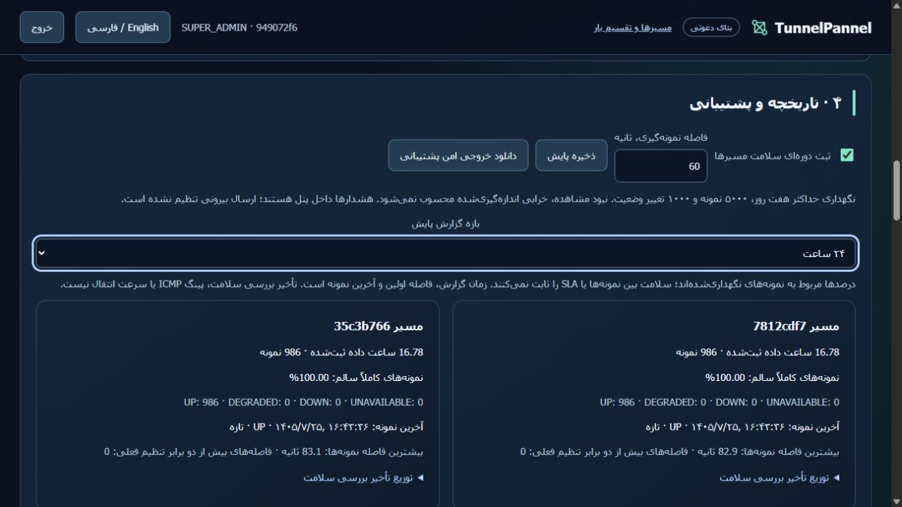

# پذیرش نصب‌شده حالت تست — ۲۰۲۶/۱۰/۱۷

[English](TEST-ONLY-VALIDATION.md) · [راهنمای استفاده](TEST-ONLY-fa.md)

هر دو سرور تست مجاز، نسخه `c300a4a9b2036b9701c8dcebdcc9b3be06676f86` را اجرا می‌کنند. زمان ثبت شواهد: `2026-10-17T13:14:56.996805+00:00`. طبق انتخاب مالک، پنل خصوصی است و دامنه یا درگاه پرداخت اضافه نشده است. main ادغام نشده؛ نصب نسخه ثابت مستقل از ادغام PR2 کار می‌کند.

## پایش و رفتار نسخه نصب‌شده

برای هر مسیر حدود **16.80 ساعت** فاصله اولین و آخرین نمونه نگهداری‌شده ثبت شده است؛ تعداد نمونه‌ها **987 و 987** است. همه نمونه‌های نگهداری‌شده این بازه ۲۴ ساعته UP هستند. این نتیجه مربوط به مشاهده‌های نقطه‌ای است و سلامت پیوسته یا SLA هفت‌روزه را ثابت نمی‌کند. هیچ فاصله ثبت، بیش از دو برابر تنظیم فعلی ۶۰ ثانیه نبود. فاصله‌های بزرگ‌تر شامل به‌روزرسانی API هستند؛ مقدار دقیق و تازگی در [شواهد امن](evidence/commercial/test-only-observation.json) آمده است.

هر چهار بازه خلاصه، روی API نصب‌شده بررسی شد: رد ورود بدون احراز هویت با401، رد بازه نامعتبر با422، no-store، شناسه مسیرهای همان مشتری و نبود اسرار در خروجی پشتیبانی. مشخصات دو ورودی، همان۷+۵ عضو، حالت تقسیم بار و PID پردازش هر درگاه در طول به‌روزرسانی ثابت ماندند. پس از آزمون کنترلی localhost هم هر۱۲ عضو سالم بودند. اثبات خروجی عمومی تک‌تک اعضا و مانور خرابی قبلی در [پذیرش پیشین](COMMERCIAL-VALIDATION-fa.md) محفوظ‌اند و به‌عنوان مانور تازه گزارش نشده‌اند.

## بار محدود درخواست کوتاه

آزمون اصلی **۲۰۱۰ پاسخ معتبر از۲۰۱۰ درخواست TCP** داشت: در هر جهت۵۲۵ درخواست افزایشی و۴۸۰ درخواست کم‌بارتر. آزمون افزایشی سطح‌های۱،۸،۳۲،۶۴ اتصال هم‌زمان و پنج دور داشت. بخش کم‌بارتر،۸ اتصال هم‌زمان در۶۰ دور با وقفه۱۰ ثانیه بود. این بخش‌ها پیش از به‌روزرسانی API با درگاه‌های پذیرفته‌شده `d757fa8` اجرا شدند. نسخه تازه فقط گزارش پایش و ابزار اختیاری تست را تغییر می‌دهد؛ کد تونل و درگاه تغییر نکرده است. ابزار نهایی نصب‌شده، **۴ پاسخ معتبر دیگر** با مهلت۱۴۰ میلی‌ثانیه گرفت و روی هر دو سرور بازنویسی تنظیم درگاه یا فایل گزارش موجود را رد کرد.

| مسیر | مرحله | رسید معتبر | مدت، ثانیه | هم‌زمانی آخرین سطح | p95 آخرین سطح، ms | بیشینه CPU نمونه‌ای میزبان | کمینه RAM در دسترس، MiB |
|---|---|---:|---:|---:|---:|---:|---:|
| `35c3b766` | ramp | 525/525 | 33.183 | 64 | 1417.758 | 21.190 | 260.2 |
| `35c3b766` | soak | 480/480 | 610.038 | 8 | 48.907 | 21.053 | 247.3 |
| `7812cdf7` | ramp | 525/525 | 38.636 | 64 | 1977.341 | 19.298 | 192.5 |
| `7812cdf7` | soak | 480/480 | 626.963 | 8 | 1020.227 | 9.199 | 193.5 |

در آزمون افزایشی، شمارنده همه۷+۵ عضو افزایش یافت. در مرحله کم‌بارتر، یکی از جهت‌ها فقط از۴ عضو از۷ عضو استفاده کرد؛ جهت دیگر از هر۵ عضو. انتخاب وزنی بر اساس کیفیت، تقسیم مساوی را تضمین نمی‌کند. شمارنده شامل ترافیک دیگر درگاه هم هست و آمار CPU/RAM مربوط به کل میزبان است.

تأخیر بالای درخواست کوتاه، روی همان مقصدها از **localhost خود مقصد و بدون تونل** نیز بازتولید شد: p95 با۸ اتصال حدود۱٫۰۱/۱٫۰۲ ثانیه و با۶۴ اتصال حدود۱٫۴۶/۱٫۴۷ ثانیه بود؛ این کنترل۷۲۰ رسید معتبر جدا داشت. صف پذیرش پیش‌فرض سرور HTTP پایتون نصب‌شده۵ است. این نتیجه محدودیت مهم مقصد آزمایش را نشان می‌دهد، اما سهم دقیق همه عوامل تأخیر را جدا نمی‌کند. این اعداد، پهنای باند، پینگ ICMP، جیتر بسته، مصرف بایت هر عضو یا تضمین سرعت مشتری نیستند. مکث عمدی۱۵۰ میلی‌ثانیه از تأخیر کنار گذاشته شده است. [تمام اعداد مراحل و کنترل localhost](evidence/commercial/test-only-quality.json).

## تست و بازیابی

CI نسخه نهایی: [portable39035240610](https://github.com/DashSaman/TunnelPannel/actions/runs/39035240610) و [security39035240599](https://github.com/DashSaman/TunnelPannel/actions/runs/39035240599) موفق شدند. روی هر کدام از Python3.11/3.12، تعداد۷۰۰ تست اصلی،۱۰۰ تست TunnelGuard و۱ تست backend پاس شد. نصب تازه و مجدد، بکاپ‌ـ‌تغییرـ‌بازیابی، حذف امن با حفظ منبع نامرتبط و بررسی شل لینوکس هم موفق بودند. اجرای کامل تازه ویندوز:۶۷۸ پاس و۲۲ مورد مخصوص محیط دیگر. قواعد ضروری Ruff و نحو JavaScript پنل پاس شدند. هشدارهای منسوخ‌شدن بعضی وابستگی‌ها باقی‌اند. [شناسه و تعداد دقیق](evidence/commercial/test-only-verification.json).

مرورگر زنده: فارسی/انگلیسی، تغییر بازه یک و۲۴ ساعت، بازکردن جدول صدک‌ها و نمایش موبایل۳۹۰ پیکسل بررسی شد؛ عرض محتوا و صفحه در هر دو زبان۳۷۵ بود و تنظیم موقت اندازه به حالت عادی برگشت. روی هر سرور بکاپ پیش از ارتقا و نسخه جاری موجود است؛ checksum هر دو بکاپ جاری تأیید شد. این دو فایل تازه دوباره restore نشدند؛ نتیجه restore واقعی قبلی دو سرور و restore تازه CI جدا محفوظ‌اند. کلید مستقل هر نصب تغییر نکرد. [شواهد نصب و بکاپ](evidence/commercial/test-only-installed.json).

جمع‌کننده خصوصی ابتدا کلید نتیجه NodeRemote را اشتباه خواند؛ شکست آن حفظ شد و فایل‌های کامل و موفق آزمون افزایشی بدون پنهان‌کردن داده یا اجرای دوباره پذیرفته شدند. تست رگرسیون، مصرف‌شدن مهلت کوتاه توسط مکث۱۵۰ میلی‌ثانیه و امکان انتخاب فایل تنظیم به‌عنوان خروجی را آشکار کرد؛ هر دو پیش از نصب نسخه نهایی اصلاح و تأیید شدند. اجرای اولیه تست ویندوز تنظیم مسیر import و UTF-8 نداشت؛ اجرای کامل اصلاح‌شده بالا نتیجه نهایی است.

## نصب تک‌خطی

```sh
curl -fsSL https://raw.githubusercontent.com/DashSaman/TunnelPannel/c300a4a9b2036b9701c8dcebdcc9b3be06676f86/install.sh | sudo env TUNNELPANNEL_VERSION=c300a4a9b2036b9701c8dcebdcc9b3be06676f86 bash
```



[نمای انگلیسی](evidence/commercial/screenshots/observation-en.png) · [موبایل فارسی](evidence/commercial/screenshots/observation-mobile-fa.png) · [موبایل انگلیسی](evidence/commercial/screenshots/observation-mobile-en.png)
