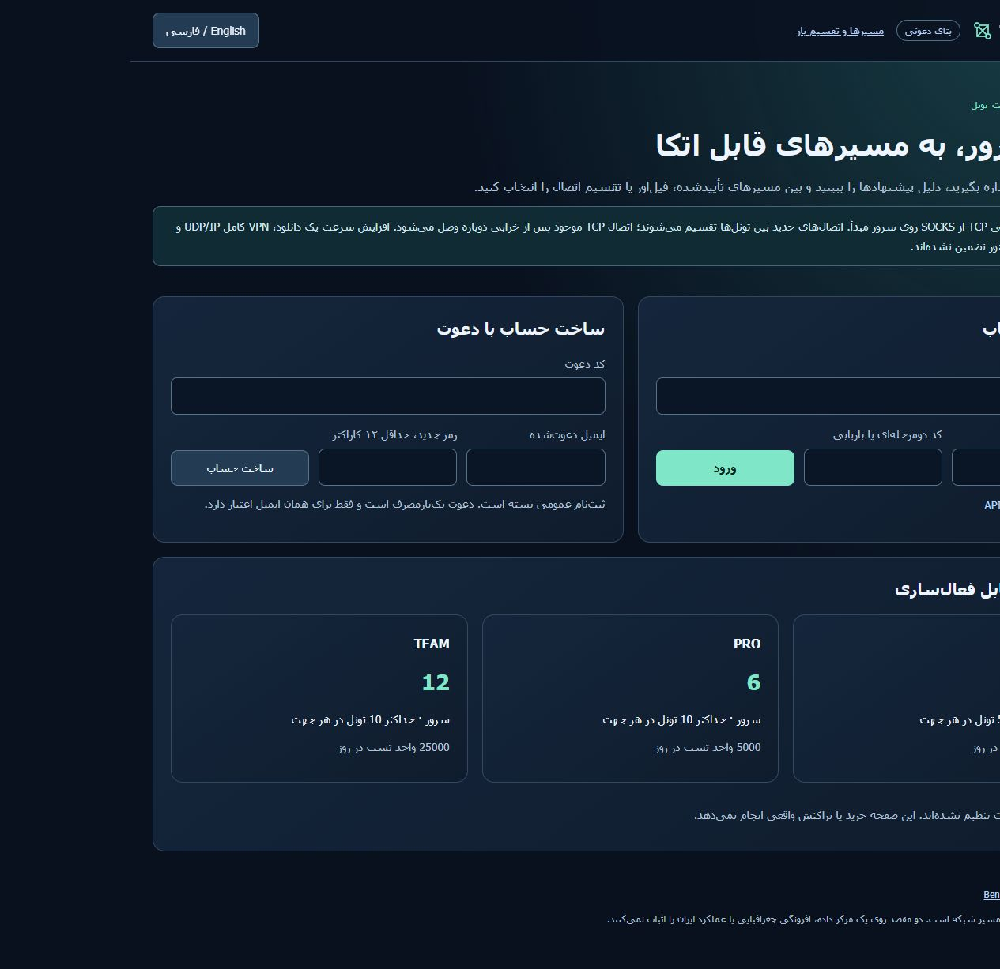

# WaterWall repair and website-only deployment — 2026-10-18

The intermittent response truncation was reproduced and repaired. Tehran
Network now provides a private website entry; the controller, customer database,
queue, scoring, compilation, benchmarks and tunnel workers run on the two
separate authorized test nodes. The website host does not contain a canonical
TunnelPannel API installation or customer database.

## Revisions and reproducibility

- Installed controller revision on both nodes: `882e69d8af31616f4022ca5ddabb11f31c5b587d`,
  tree `9b2e61253f2cae51e04585f29ea43baafc1ec812`.
- Installed website gateway / complete installer pin:
  `d68556d17f8b4a8276bc4c2344139bffc9329042`,
  tree `05cecf03ee7293badc10dadb5f4941587b498d96`.
  The difference from the API revision is confined to gateway directory
  permissions and its regression test; backend and engine code are identical.
- WaterWall-H source: `613bb32c93db40b09cb915070e5f7ff09ad3c81d`,
  patch set `ca1-h2drain6`; identical installed amd64 binary on both nodes:
  `4244a3b394d73a2629d0d2912e5f4ae12acfe1d791e32ce6c116a1b82dc6e9cb`.
  Twelve transport/event source files and clean build provenance were checked; the separately documented owned-CA modification remains enabled.
- CI for the complete code pin: [portable and Linux install lifecycle](https://github.com/DashSaman/TunnelPannel/actions/runs/39147966187)
  and [security checks](https://github.com/DashSaman/TunnelPannel/actions/runs/39147966116)
  succeeded. Python 3.11 and 3.12 each passed 749 canonical, 100 TunnelGuard
  and 1 backend tests; the Linux installer/backup/restore/uninstall job passed.

Documentation publication follows these immutable runtime pins. `main` is
unmerged; [PR #2](https://github.com/DashSaman/TunnelPannel/pull/2) remains the
review boundary. [One-line backend installer](../install-one-line.txt) belongs
on an execution/controller host. Use the separate [gateway installer](WEB-GATEWAY.md)
on a website host.

## Cause and fix

The original owner campaign retains its 215 successes and one failed reverse
HTTP2/TLS transfer (`curl 18`, 112 missing bytes). Repeated isolated tests also
reproduced truncated tails; a 1,000-transfer baseline had two failures. Direct
origin controls passed. An earlier receive-order-only candidate still failed
once in 1,000 transfers and was not accepted as the fix.

Instrumentation traced the final encrypted frame across HTTP2 and TCP. A
software-empty output queue did not imply that the peer had received the
response. Closing the Linux socket while late HTTP2 control bytes remained
unread sent a TCP reset; the peer could lose its unread response tail. A
deterministic real TCP seam reproduced the dropped tail with hard close and
delivered it completely with orderly half-close, on both nodes.

The accepted patch first delivers parsed HTTP2 DATA before a reentrant control
write can destroy receive state. Detached TCP listeners then flush pending
writes, send FIN and consume late input until EOF or a bounded grace timeout.
Application callbacks are detached, repeated closes cannot abort the drain,
the original pending-write deadline remains in force, and the read grace is
separate. TLS certificate verification and bounded queue backpressure remain
enabled. Strict source anchors and a cache per source pin/patch set prevent
accidentally building a different cached revision. Linux C regression seams
exercise receive ordering, ownership, repeated close, EOF and both deadlines.
The TCP comparison produced 40/40 dropped baseline tails versus 40/40 complete
patched tails on each node.

## Physical and installed acceptance

The corrected engine passed 3,000 full-stack transfers in each direction and
3,000 reverse HTTP2/AEAD transfers with zero integrity failures. The latter
capture found no server reset before FIN. These are finite tests, not a claim
that every reset or network failure is eliminated.

Each of the four profiles was then independently exercised in both directions:
50 SHA256-checked 1 MiB transfers, a 60-second integrity-checked throughput run,
latency probes and restart/recovery of the QA-owned engine. All eight checks
passed; only their allocated resources were released.

A fresh campaign through the **installed API**, after upgrading both nodes,
also passed all eight DEEP results: HTTP2/TLS, WebSocket/TLS, Reality and VLESS
Reality in each direction. Every result includes 100 HTTP RTT samples,
integrity-checked throughput, recovery and cleanup evidence. Exact metrics and
the final preservation/canary receipts are in
[the allowlisted evidence](evidence/commercial/waterwall-gateway-installed.json).
The focused campaign recommends four because four methods were selected; it
does not manufacture a fifth result.

Benchmark cleanup now finalizes successfully released deployments as
`ROLLED_BACK`; failed cleanup remains failed and retains its allocation ledger.
Recovery marks only unfinished runs of interrupted jobs as `INTERRUPTED` after
cleanup succeeds. Fresh backups preceded a one-time repair of 1,091 historical
already-released deployment states and three stale unfinished runs. Job,
sample, receipt and allocation fingerprints were unchanged; historical verdicts
were never rewritten. These repairs are not scripts to replay.

## Website gateway and preservation

The target runs only two dedicated unprivileged units: SSH local forwarding
with a restricted account, pinned host key and a single allowed controller API
destination, plus an independent nginx instance. The chosen HTTP/transport
ports are loopback-only. The canonical port allocator and fresh inventory reject
occupied or reserved ports. Installer/uninstaller guards refuse foreign paths,
symlink ancestors and foreign effective service commands before taking ownership.

The first gateway start exposed a restrictive-umask directory permission bug;
its failed receipt was retained. Explicit directory modes and a regression
test fixed it. The retry retained the same key and ports and passed health and
listener-owner checks. No global nginx/site configuration was edited or reloaded.
An external website-snippet change observed **before** installation was recorded
separately and was not reverted. The immediate preinstall baseline then matched:
five selected service PIDs, 11 container identities/start times, 50 links and
29 nginx files. All current route entries, ordered methods, modes, pins,
complete configuration hashes and gateway worker PIDs are preserved.

Limits are 10% CPU per gateway unit, 64 MiB for SSH and 96 MiB for nginx; these
are limits rather than traffic-capacity promises. A postinstall cgroup snapshot
was about 3 MB combined. UI checks through the actual forwarding chain passed
in Persian/RTL and English/LTR; at a 390 px viewport both document widths were
375 px with no horizontal overflow. Missing/invalid API credentials returned
401; the original valid workspace could read its two nodes and campaign.

Fresh per-node backups, separate installation env/keys and a separate gateway
transport-key/config archive are kept privately, with checksum and encrypted
DPAPI byte-equality verification. DPAPI rescue requires the same Windows
account/machine. Server originals remain available; no restore was performed
over live data. No endpoint was deleted.

## Sale and capacity boundary

The requested future architecture is established: the website forwards requests
to the remote controller, which authenticates the customer, checks workspace
entitlements/quotas and schedules node work. Existing connection sharing spreads
new TCP connections over healthy members; it does not bond a single download.
Current groups retain their failover/balance modes.

Actual pay-per-use charging is not enabled. Before taking money, implement
priced orders and credit reservation, idempotent settlement/refund on terminal
job outcomes, and a verified payment-provider flow. No domain, payment provider,
SSO or public website cutover was added in this test scope. The two datacenter
nodes do not establish Iran-route performance, geographic independence,
many-customer capacity or a continuous SLA. Keep execution hosts while they
contain customer workspaces or live tunnels.

[GoldWaterTunnel](https://github.com/DashSaman/GoldWaterTunnel) was also reviewed:
its direct WireGuard path is already covered and its Reality/VLESS ideas are
represented by the measured profiles. Its README performance numbers are not
our measurements. No arbitrary new protocol combination is counted as supported
without a compatible paired recipe and a physical result.
