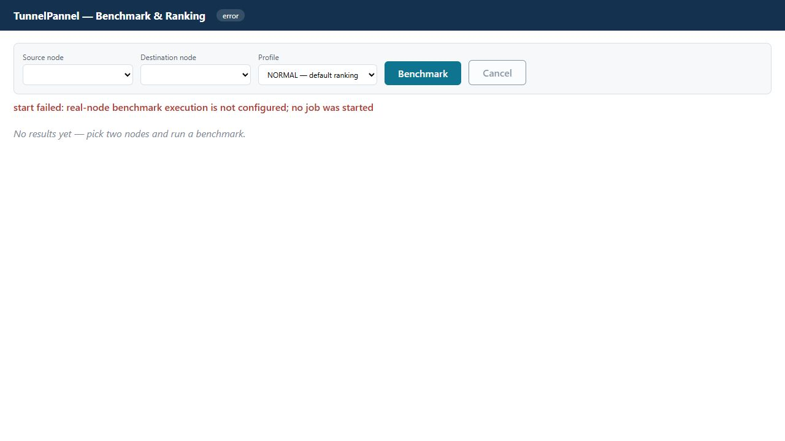
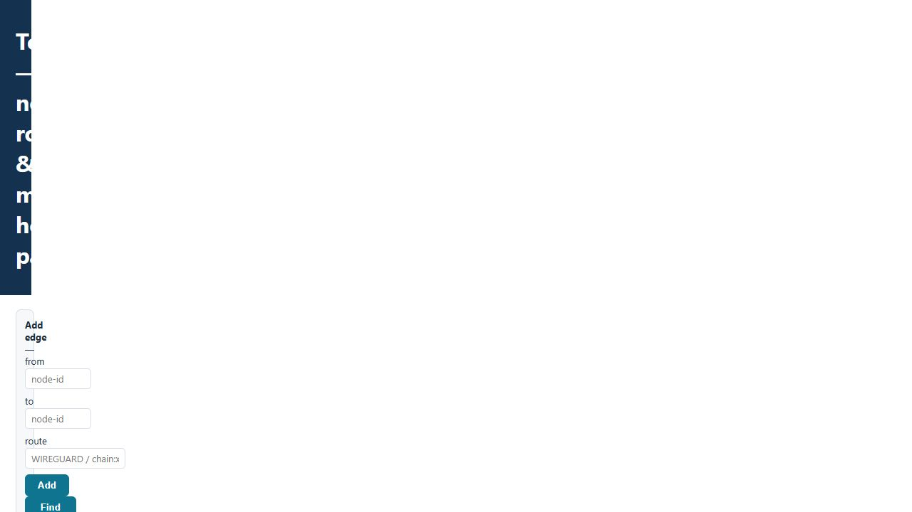

# v0.9.0-rc2 — measured server validation / گزارش تست واقعی

Date: 2026-10-13. **Production release gate: BLOCKED.** This is a tested corrective candidate, not a claim that all 76 canonical profiles are operational.

تاریخ: ۱۳ اکتبر ۲۰۲۶. **انتشار Production هنوز مسدود است.** نسخهٔ اصلاح‌شده قابل نصب است؛ این گزارش تأیید کارکرد همهٔ پروفایل‌ها نیست.

## Actual results / نتایج واقعی

| Scope / محدوده | Result / نتیجه |
|---|---|
| Canonical Python suite | 486 PASS, 0 FAIL, 0 skipped |
| TunnelGuard Linux suite | 100 PASS, 0 FAIL, 0 skipped |
| Backend import suite | 1 PASS |
| Ruff + canonical ShellCheck + catalog generators | PASS |
| Canonical dependency audit (`pip-audit -r requirements-canonical.txt`) | No known vulnerabilities found at test time |
| Legacy 82-method isolated lab | 32 PASS / 23 PARTIAL / 27 FAIL |
| Two-node pinned-key SSH preflight + inventory | PASS, read-only |
| Fresh install + second run | PASS on two Ubuntu 24.04.4 x86_64 VPSs |
| SQLite backup → insert marker → restore → marker absent | PASS |
| Upgrade, custom-port persistence + restore, safe uninstall + reinstall | PASS |

Software tests exercise contracts, configuration and API behavior. The lab is loopback/network-namespace evidence. Neither is a substitute for two-server traffic.

تست‌های نرم‌افزاری و آزمایشگاهی با عبور ترافیک بین دو VPS یکسان نیستند؛ نتایج این سه محدوده جدا ثبت شده‌اند.

## Real pair / عبور داده بین دو سرور

| Method | Measured inner traffic | Result |
|---|---|---|
| WireGuard | IPv4 + IPv6, bidirectional | PASS |
| GRE | IPv4 + IPv6, bidirectional | PASS |
| GRETAP | IPv4 + IPv6, bidirectional | PASS |
| IPIP | IPv4, bidirectional (IPv6 not applicable) | PASS |
| SIT | IPv6 over IPv4 underlay, bidirectional | PASS |
| VXLAN | IPv4 + IPv6, bidirectional | PASS |

Failover drill: bring the verified WireGuard interface down, observe two failed probes, let the canonical FSM select GRE, apply that decision to the drill's dedicated host route, then receive **5/5 packets via GRE**. This proves the FSM plus route-switch drill; it does not prove an unattended production daemon. Default management routes survived, and test interfaces were removed.

در تست سوییچ مسیر، WireGuard عمداً قطع شد، دو probe ناموفق ثبت شد، FSM مسیر GRE را انتخاب کرد و اجراکنندهٔ تست مسیر اختصاصی را تغییر داد؛ سپس هر پنج بسته از GRE عبور کرد. این نتیجه به‌معنای تکمیل daemon خودکار پنل نیست.

## Remaining release blockers / موارد باقی‌مانده

1. The canonical API still lacks production executor/SSH deployment wiring. It now refuses benchmark startup with **HTTP 503 before creating a job**, instead of accepting a job that cannot execute.
2. The 27 failed and 23 partial legacy profiles need method-specific implementation/configuration work and real-pair receipts. GOST TUN/TAP, sing-box TUN and HAJSAMAN aliases no longer receive a full-profile PASS for testing only a carrier or kernel component.
3. Full chain and multi-hop validation remains incomplete. Two supplied nodes cannot prove a three-node path. Adding a third node alone also does not implement the real path driver.
4. Only Ubuntu 24.04.4/Python 3.12 was tested on these VPSs. Other OS versions and architectures are not implied by these results.

اتصال اجرای واقعی موتور به API، رفع روش‌های ناقص/ناموفق و تست واقعی زنجیره‌ها هنوز لازم است. کانال نصب همچنان development باقی می‌ماند و برچسب stable صادر نشده است.

## Corrective changes / اصلاحات

- Installer follows the fetched branch head, preserves configuration and custom ports, refuses to overwrite local source edits, grants its service read/execute access to root-owned source, and displays bootstrap tokens before later stages can fail. Raw tokens bypass the persistent install log.
- Backup schema inspection runs from the application directory, including when the operator starts it from `/root`.
- Real preflight wraps actual SSH channels, rejects failed route queries, persists management-route baselines for resume, and never turns synthetic failover/multihop data into a real PASS.
- Failed teardown remains unreleased in the ownership ledger. Blocked profiles never roll back resources they did not create. Install resources survive into dependent lifecycle stages. Uninstall probes never delete an unrelated directory.
- Port roles in one allocation receive distinct ports. WireGuard requires exchanged peer keys, uses valid shell syntax and includes optional IPv6 subnets in allowed-IPs.
- Benchmark results/receipts are isolated by job/run. API tests use separate SQLite connections rather than concurrently sharing one in-memory connection.
- UDP probes do not create the tested listener; FRP transport-port conflicts and Chisel remote syntax were corrected. The lab wrapper isolates network, process and mount namespaces.
- The UI now shows benchmark startup failures and resets its status instead of hiding the error.
- Legacy auth now uses PyJWT with HS256 allowlisting; expired, malformed, wrong-key and wrong-algorithm tokens are rejected. The old jose/ecdsa audit exception was removed.
- CI installer acceptance pins the PR head, rather than inadvertently installing the old default branch. Historical Gitleaks exceptions are exact fingerprints of public source-file digests, not credentials.

## Operator access / دسترسی اپراتور

The service is `tunnelpannel-api`, listening on `127.0.0.1:8080`. Use an SSH tunnel:

```sh
ssh -L 8080:127.0.0.1:8080 root@YOUR_SERVER
```

Then open `http://127.0.0.1:8080/ranking` or `/topology`. The current canonical UI has no completed remote deployment flow; the visible 503 is intentional and honest.

Bootstrap role tokens appear once on the installer's original stdout; save them when shown. They are stored only as hashes in `/etc/tunnelpannel/tunnelpannel.env`. The agent-created test installations have a separate root-only access file at `/root/tunnelpannel-access.txt`; that file is not part of the repository or deliverable.

رمزهای root، کلیدهای SSH و توکن‌های واقعی در کد یا گزارش عمومی قرار نگرفته‌اند. رمزهایی که در چت فرستاده شده‌اند را پس از تحویل تغییر دهید.




## All 82 lab verdicts / نتیجهٔ تک‌تک ۸۲ روش

PASS below means the isolated legacy lab's data probe passed. It is not a production readiness or real-pair label.

| Method | Verdict | Duration ms |
|---|---|---|
| `AUTOSSH_REVERSE` | FAIL | 240071 |
| `CHISEL_REVERSE_SOCKS5` | PASS | 3680 |
| `CHISEL_REVERSE_TCP` | PASS | 3372 |
| `CHISEL_REVERSE_UDP` | PASS | 3342 |
| `CHISEL_SOCKS5` | PASS | 3366 |
| `CHISEL_TCP` | PASS | 3356 |
| `CHISEL_UDP` | PASS | 4344 |
| `FRP_KCP` | PASS | 3652 |
| `FRP_QUIC` | PASS | 3567 |
| `FRP_STCP` | PARTIAL | 5066 |
| `FRP_TCP` | FAIL | 3065 |
| `FRP_UDP` | FAIL | 6042 |
| `FRP_XTCP` | PARTIAL | 17080 |
| `GOST_GRPC` | PASS | 672 |
| `GOST_HTTP` | PASS | 366 |
| `GOST_HTTP2` | PASS | 382 |
| `GOST_KCP_FORWARD` | FAIL | 685 |
| `GOST_QUIC` | PASS | 368 |
| `GOST_REMOTE_TCP` | PASS | 1584 |
| `GOST_REMOTE_UDP` | FAIL | 3641 |
| `GOST_SOCKS5` | PASS | 363 |
| `GOST_SOCKS5_KCP` | PASS | 347 |
| `GOST_SSH` | PASS | 340 |
| `GOST_TAP` | PARTIAL | 4660 |
| `GOST_TCP_FORWARD` | PASS | 353 |
| `GOST_TUN` | PARTIAL | 6672 |
| `GOST_UDP_FORWARD` | FAIL | 12042 |
| `GOST_WS` | PASS | 341 |
| `GRE` | PASS | 1119 |
| `GRETAP` | PASS | 1122 |
| `GRETAP_OVER_GOST` | FAIL | 240092 |
| `GRE_OVER_GOST` | FAIL | 2048 |
| `GRE_OVER_SSH` | FAIL | 1435 |
| `GRE_OVER_WIREGUARD` | PASS | 3098 |
| `HAJSAMAN_FULL` | PARTIAL | 2155 |
| `HAJSAMAN_SIT` | PARTIAL | 1126 |
| `HAJSAMAN_WG` | PARTIAL | 2162 |
| `HEDIOUM_POOL_SOCKS` | PARTIAL | 140 |
| `HEDIOUM_TUN` | PARTIAL | 54 |
| `HYSTERIA2` | PARTIAL | 83 |
| `IKEV2_IPSEC` | FAIL | 1184 |
| `IP6GRE` | FAIL | 3130 |
| `IP6GRETAP` | PASS | 2267 |
| `IPIP` | PASS | 1126 |
| `L2TP_IPSEC` | FAIL | 209 |
| `OPENVPN` | FAIL | 682 |
| `PAQET_RAW_KCP` | PARTIAL | 93 |
| `PAQET_SOCKS5` | PARTIAL | 2080 |
| `RATHOLE_NOISE` | PARTIAL | 4744 |
| `RATHOLE_TCP` | PASS | 4569 |
| `RATHOLE_TLS` | PARTIAL | 4568 |
| `RATHOLE_UDP` | PARTIAL | 38 |
| `RATHOLE_WEBSOCKET` | PARTIAL | 4552 |
| `SHADOWSOCKS` | PASS | 2421 |
| `SINGBOX_TUN` | PARTIAL | 2424 |
| `SIT_6IN4` | PASS | 1122 |
| `SIT_OVER_GOST` | FAIL | 2664 |
| `SIT_OVER_SSH` | FAIL | 1423 |
| `SSH_DYNAMIC_SOCKS` | FAIL | 1375 |
| `SSH_LOCAL_FORWARD` | FAIL | 1371 |
| `SSH_REMOTE_FORWARD` | FAIL | 1361 |
| `SSH_TAP_L2` | FAIL | 903 |
| `SSH_TUN_L3` | FAIL | 1395 |
| `TROJAN_TLS` | PASS | 2439 |
| `TUIC` | PARTIAL | 77 |
| `VLESS_GRPC` | FAIL | 2548 |
| `VLESS_REALITY` | FAIL | 2396 |
| `VLESS_TCP` | FAIL | 2368 |
| `VLESS_VISION_REALITY` | PARTIAL | 42 |
| `VLESS_WS` | FAIL | 2361 |
| `VLESS_XHTTP` | FAIL | 2362 |
| `VLESS_XHTTP_REALITY` | PARTIAL | 45 |
| `VTI` | FAIL | 1148 |
| `VTI6` | FAIL | 1161 |
| `VXLAN` | PASS | 1112 |
| `WATERWALL_DIRECT` | PARTIAL | 6083 |
| `WATERWALL_REVERSE` | PARTIAL | 6099 |
| `WATERWALL_TLS_MUX` | PARTIAL | 6095 |
| `WIREGUARD` | PASS | 2161 |
| `WSTUNNEL_SOCKS5` | PASS | 4052 |
| `WSTUNNEL_TCP` | PASS | 4047 |
| `WSTUNNEL_UDP` | PASS | 4042 |
